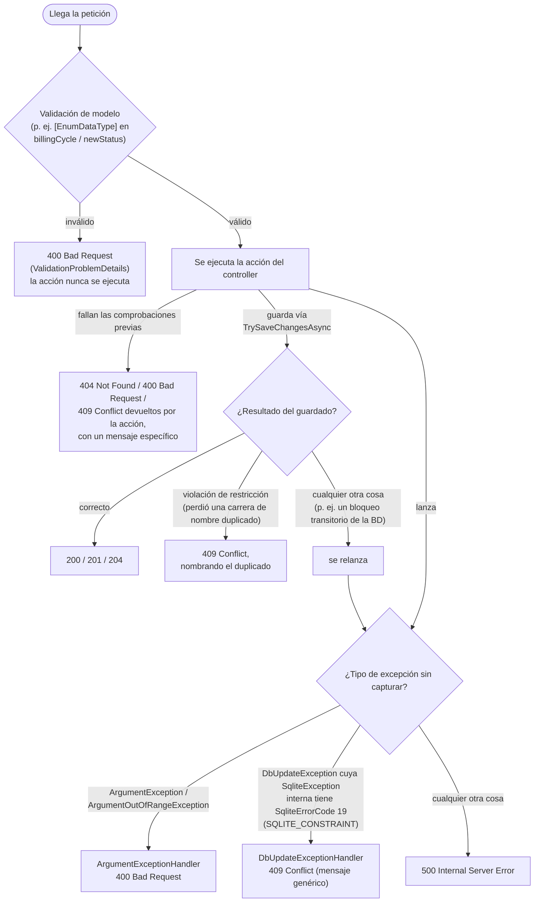
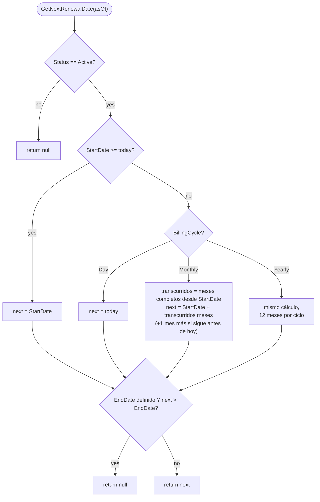

# 🌐 Referencia de la API

[🇬🇧 English](./Api.en.md) | 🇪🇸 **Español**

> Endpoints HTTP que expone el backend (API Web de ASP.NET Core), qué espera recibir cada uno y qué devuelve, incluyendo los códigos de estado. Ver [Base de Datos](../Database/Database.es.md) para el esquema subyacente.

---

## 📋 Índice

1. [Notas generales](#notas-generales)
2. [Categories](#-categories)
3. [Subscriptions](#-subscriptions)
4. [Price Histories](#-price-histories)
5. [Expenses](#-expenses)
6. [Referencia de códigos de estado](#-referencia-de-códigos-de-estado)

---

## ℹ️ Notas generales <a id="notas-generales"></a>

- URL base (desarrollo local): `http://localhost:<puerto>/api` (el puerto sale de `Properties/launchSettings.json`).
- Todas las peticiones/respuestas usan `Content-Type: application/json`.
- Actualmente **no hay autenticación** — la app es local-first y mono-usuario (ver [Alcance del Proyecto](../ProjectScope/ProjectScope.es.md)).
- ✅ Dos manejadores globales de excepciones (registrados vía `app.UseExceptionHandler()`) convierten los fallos esperados en códigos de estado correctos en vez de un `500` sin control: `ArgumentExceptionHandler` traduce los fallos de las validaciones del dominio (`ArgumentException`/`ArgumentOutOfRangeException` — un `name` vacío, un `price` negativo, cambiar el precio o el estado al mismo valor) en `400 Bad Request`; `DbUpdateExceptionHandler` traduce una violación **real** de una restricción de la base de datos (`DbUpdateException` que envuelve un error `SQLITE_CONSTRAINT` de SQLite — p. ej. borrar una categoría que todavía tiene suscripciones) en `409 Conflict`. Ambos devuelven un cuerpo `ProblemDetails`.
- ✅ Los conflictos de nombre duplicado (`409`) ya están manejados de forma segura, incluso ante peticiones concurrentes: el controller comprueba primero si ya existe un duplicado, y la restricción única de la base de datos actúa como red de seguridad si dos peticiones llegan a la vez y superan esa comprobación — en cualquiera de los dos casos se devuelve `409` con un mensaje que nombra el duplicado, nunca un `500` sin control. Los controllers guardan a través de un helper compartido `TrySaveChangesAsync` para esa segunda ruta, así que los cuatro endpoints de escritura hacen esta distinción de forma idéntica.
- ✅ `billingCycle` y `newStatus` se validan contra los valores definidos de su enum (vía `[EnumDataType]`). Un entero no definido (p. ej. `"billingCycle": 999`) se rechaza con `400 Bad Request` por la validación de modelo integrada de `[ApiController]` de ASP.NET Core — nunca llega a la capa de dominio ni se guarda. Esta respuesta tiene una forma algo distinta a la de arriba: `{"title": "One or more validation errors occurred.", "status": 400, "errors": {"BillingCycle": ["The field BillingCycle is invalid."]}}` (un `ValidationProblemDetails`, no el `ProblemDetails` simple que devuelven los manejadores de excepciones).
- ✅ Solo una violación de restricción genuina se convierte en `409`. Un error transitorio de la base de datos (p. ej. "database is locked" de SQLite bajo escrituras concurrentes) también es un `DbUpdateException`, pero **no** es un conflicto de datos — informarlo como `409` le diría al cliente "no reintentes, tus datos están obsoletos" cuando la respuesta correcta es "reintenta, ha sido un bache puntual". Tanto el manejador global como el `TrySaveChangesAsync` de los controllers comprueban específicamente `SQLITE_CONSTRAINT` (una única comprobación compartida, `IsConstraintViolation`), así que un fallo transitorio se deja a propósito salir como un `500` genuino.


> Tanto `TrySaveChangesAsync` como `DbUpdateExceptionHandler` deciden con la misma comprobación compartida `IsConstraintViolation`. La diferencia es solo el mensaje: un controller que sabe *qué* nombre ha colisionado lo dice, mientras que el manejador global — que captura p. ej. el `RESTRICT` al borrar una categoría en uso — devuelve un mensaje de conflicto genérico.

---

## 📁 Categories

### `GET /api/Categories`

Devuelve todas las categorías.

**Respuesta `200 OK`**
```json
[
  {
    "id": 1,
    "name": "Streaming",
    "createdAt": "2026-11-01T10:00:00Z"
  }
]
```

---

### `GET /api/Categories/{id}`

Devuelve una categoría concreta por su id.

**Respuesta `200 OK`**
```json
{
  "id": 1,
  "name": "Streaming",
  "createdAt": "2026-11-01T10:00:00Z"
}
```

**Respuesta `404 Not Found`** — no existe ninguna categoría con ese `id` (cuerpo vacío).

---

### `POST /api/Categories`

Crea una categoría.

**Cuerpo de la petición**
```json
{
  "name": "Streaming"
}
```

**Respuesta `201 Created`**
Cabecera `Location: /api/Categories/{id}`
```json
{
  "id": 1,
  "name": "Streaming",
  "createdAt": "2026-11-01T10:00:00Z"
}
```

**Respuesta `409 Conflict`** — ya existe una categoría con ese `name` (sin distinguir mayúsculas/minúsculas).

**Respuesta `400 Bad Request`** — si `name` está vacío/en blanco.

---

### `PUT /api/Categories/{id}`

Renombra una categoría existente.

**Cuerpo de la petición**
```json
{
  "name": "Streaming & VOD"
}
```

**Respuesta `204 No Content`** — actualización correcta, sin cuerpo.

**Respuesta `404 Not Found`** — no existe ninguna categoría con ese `id`.

**Respuesta `409 Conflict`** — ya existe otra categoría con ese `name` (sin distinguir mayúsculas/minúsculas).

**Respuesta `400 Bad Request`** — si `name` está vacío/en blanco.

---

### `DELETE /api/Categories/{id}`

Elimina una categoría.

**Respuesta `204 No Content`** — borrado correcto, sin cuerpo.

**Respuesta `404 Not Found`** — no existe ninguna categoría con ese `id`.

**Respuesta `409 Conflict`** — si la categoría todavía tiene suscripciones asignadas. La base de datos aplica `ON DELETE RESTRICT` en `Subscriptions.CategoryId` (ver [Base de Datos](../Database/Database.es.md#-relaciones)); la `DbUpdateException` resultante la traduce a `409` `DbUpdateExceptionHandler` (ver [Notas generales](#notas-generales)).

---

## 📁 Subscriptions

### `GET /api/Subscriptions`

Devuelve todas las suscripciones.

**Respuesta `200 OK`**
```json
[
  {
    "id": 1,
    "name": "Netflix",
    "description": "Streaming service",
    "price": 12.99,
    "billingCycle": 1,
    "startDate": "2026-01-01T00:00:00Z",
    "endDate": null,
    "createdAt": "2026-11-01T10:00:00Z",
    "updatedAt": "2026-11-01T10:00:00Z",
    "status": 0,
    "categoryId": 1
  }
]
```
> `billingCycle` y `status` son enums serializados como números enteros — ver [Base de Datos: Referencia de enums](../Database/Database.es.md#-referencia-de-enums) para la equivalencia de valores.

---

### `GET /api/Subscriptions/{id}`

Devuelve una suscripción concreta por su id.

**Respuesta `200 OK`** — misma forma que arriba (un único objeto).

**Respuesta `404 Not Found`** — no existe ninguna suscripción con ese `id`.

---

### `GET /api/Subscriptions/upcoming`

Devuelve las suscripciones **activas** (`Active`) cuya próxima renovación cae dentro de una ventana de días desde hoy, ordenadas por esa fecha (la más próxima primero). Se excluyen las `Paused`/`Cancelled`, así como las que ya han terminado (`EndDate` en el pasado).

La fecha de la próxima renovación se calcula a partir de `StartDate` — comparando por fecha de calendario, no por hora exacta. Un `StartDate` en el futuro (o exactamente hoy) es en sí mismo la primera renovación. Si no: `Day` renueva hoy; `Monthly`/`Yearly` saltan directamente a la ocurrencia correcta (cuántos ciclos completos han pasado, sumando uno más si eso cae antes de hoy) en vez de avanzar un ciclo cada vez, precisamente para que una fecha de inicio como el día 31 o el 29 de febrero solo se recorte a un mes más corto (p. ej. el 28/30) en *esa* ocurrencia — no en todas las siguientes.



**Parámetros de consulta**

| Parámetro | Tipo | Descripción |
|---|---|---|
| `withinDays` | `int` (opcional, por defecto `30`) | Cuántos días hacia adelante mirar. |

**Respuesta `200 OK`**
```json
[
  {
    "subscriptionId": 1,
    "name": "Netflix",
    "price": 12.99,
    "billingCycle": 1,
    "nextRenewalDate": "2026-12-01T00:00:00Z",
    "categoryId": 1
  }
]
```

---

### `POST /api/Subscriptions`

Crea una suscripción.

**Cuerpo de la petición**
```json
{
  "name": "Netflix",
  "description": "Streaming service",
  "price": 12.99,
  "billingCycle": 1,
  "startDate": "2026-01-01T00:00:00Z",
  "categoryId": 1
}
```

**Respuesta `201 Created`**
Cabecera `Location: /api/Subscriptions/{id}`
```json
{
  "id": 1,
  "name": "Netflix",
  "description": "Streaming service",
  "price": 12.99,
  "billingCycle": 1,
  "startDate": "2026-01-01T00:00:00Z",
  "endDate": null,
  "createdAt": "2026-11-01T10:00:00Z",
  "updatedAt": "2026-11-01T10:00:00Z",
  "status": 0,
  "categoryId": 1
}
```

**Respuesta `400 Bad Request`** — el `categoryId` no corresponde a ninguna categoría existente, `name` está vacío/en blanco, `price` es negativo, o `billingCycle` no es un valor definido.

**Respuesta `409 Conflict`** — ya existe una suscripción con ese `name` en esa categoría (sin distinguir mayúsculas/minúsculas).

---

### `PUT /api/Subscriptions/{id}`

Actualiza los datos de una suscripción. **El `price` y el `status` no son editables aquí a propósito** — solo deberían cambiar a través de `PUT /api/Subscriptions/{id}/price` y `PUT /api/Subscriptions/{id}/status` (más abajo); los cambios de precio además quedan registrados en [Price Histories](#-price-histories).

**Cuerpo de la petición**
```json
{
  "name": "Netflix Premium",
  "description": "Updated plan",
  "billingCycle": 1,
  "startDate": "2026-01-01T00:00:00Z",
  "endDate": null,
  "categoryId": 1
}
```

**Respuesta `204 No Content`** — actualización correcta, sin cuerpo.

**Respuesta `404 Not Found`** — no existe ninguna suscripción con ese `id`.

**Respuesta `400 Bad Request`** — el `categoryId` no corresponde a ninguna categoría existente, `name` está vacío/en blanco, o `billingCycle` no es un valor definido.

**Respuesta `409 Conflict`** — ya existe otra suscripción con ese `name` en esa categoría.

---

### `DELETE /api/Subscriptions/{id}`

Elimina una suscripción. Sus registros de `PriceHistory` se eliminan junto con ella (`ON DELETE CASCADE`, ver [Base de Datos](../Database/Database.es.md#-relaciones)).

**Respuesta `204 No Content`** — borrado correcto, sin cuerpo.

**Respuesta `404 Not Found`** — no existe ninguna suscripción con ese `id`.

---

### `PUT /api/Subscriptions/{id}/price`

Cambia el precio de una suscripción y registra el cambio como una nueva entrada en [Price Histories](#-price-histories). Esta es la **única** forma de cambiar el `price` — el `PUT /api/Subscriptions/{id}` general de arriba lo rechaza a propósito.

**Cuerpo de la petición**
```json
{
  "newPrice": 14.99
}
```

**Respuesta `200 OK`** — la suscripción con su `price` y `updatedAt` actualizados.
```json
{
  "id": 1,
  "name": "Netflix",
  "description": "Streaming service",
  "price": 14.99,
  "billingCycle": 1,
  "startDate": "2026-01-01T00:00:00Z",
  "endDate": null,
  "createdAt": "2026-11-01T10:00:00Z",
  "updatedAt": "2026-11-04T10:00:00Z",
  "status": 0,
  "categoryId": 1
}
```

**Respuesta `404 Not Found`** — no existe ninguna suscripción con ese `id`.

**Respuesta `400 Bad Request`** — si `newPrice` es negativo o igual al precio actual.

---

### `PUT /api/Subscriptions/{id}/status`

Cambia el estado de una suscripción (`Active`/`Paused`/`Cancelled`). No hay restricciones sobre qué transiciones están permitidas (p. ej. reactivar una suscripción cancelada es válido) — la única regla es que el nuevo estado debe ser distinto del actual.

**Cuerpo de la petición**
```json
{
  "newStatus": 1
}
```
> `newStatus` es el valor entero de `SubscriptionStatus` — ver [Base de Datos: Referencia de Enums](../Database/Database.es.md#-referencia-de-enums).

**Respuesta `200 OK`** — la suscripción con su `status` y `updatedAt` actualizados.

**Respuesta `404 Not Found`** — no existe ninguna suscripción con ese `id`.

**Respuesta `400 Bad Request`** — si `newStatus` es igual al estado actual, o no es un valor definido.

---

## 📁 Price Histories

**Solo lectura desde el punto de vista de la API.** Los registros se crean automáticamente con `PUT /api/Subscriptions/{id}/price` de arriba — no hay `POST`/`PUT`/`DELETE` directo sobre este recurso.

### `GET /api/PriceHistories`

Devuelve todos los registros de historial de precios, opcionalmente filtrados por suscripción.

**Parámetros de consulta**

| Parámetro | Tipo | Descripción |
|---|---|---|
| `subscriptionId` | `int` (opcional) | Solo devuelve los registros de esta suscripción. |

**Respuesta `200 OK`**
```json
[
  {
    "id": 1,
    "subscriptionId": 1,
    "oldPrice": 9.99,
    "newPrice": 12.99,
    "changedAt": "2026-11-01T10:00:00Z"
  }
]
```

---

### `GET /api/PriceHistories/{id}`

Devuelve un registro de historial de precios concreto por su id.

**Respuesta `200 OK`** — misma forma que arriba (un único objeto).

**Respuesta `404 Not Found`** — no existe ningún registro con ese `id`.

---

## 📁 Expenses

**Solo lectura, datos agregados.** No es un recurso propio — informa sobre `Subscriptions`.

### `GET /api/Expenses/summary`

Devuelve el coste mensual y anual total de todas las suscripciones **activas** (`Active`). Las suscripciones `Paused` y `Cancelled` no cuentan.

El coste de cada suscripción se convierte a su equivalente anual antes de sumar — `Day` × 365, `Monthly` × 12, `Yearly` tal cual — y el total mensual es esa suma dividida entre 12. Ambos totales se redondean a 2 decimales solo al final, para que el redondeo de una suscripción no desvíe la suma.

**Respuesta `200 OK`**
```json
{
  "monthlyTotal": 22.98,
  "yearlyTotal": 275.76,
  "activeSubscriptionCount": 2
}
```

---

## 🔢 Referencia de códigos de estado

| Código | Significado | Cuándo se usa |
|---|---|---|
| `200 OK` | Éxito, con cuerpo de respuesta | Peticiones `GET` que encuentran datos, y `PUT /api/Subscriptions/{id}/price`/`/status` (devuelven la suscripción actualizada en vez de `204`, para que el cliente vea el nuevo valor sin un `GET` posterior). |
| `201 Created` | Recurso creado | `POST` exitoso. Incluye una cabecera `Location` apuntando al nuevo recurso. |
| `204 No Content` | Éxito, sin cuerpo | `PUT`/`DELETE` exitosos (excepto `PUT .../price` y `PUT .../status`, ver arriba). |
| `400 Bad Request` | Referencia inválida, fallo de validación del dominio, o fallo de validación de enum | `POST`/`PUT` en `Subscriptions` con un `categoryId` que no existe, un `name` vacío, un `price` negativo, un `billingCycle`/`newStatus` no definido, un cambio de precio al mismo valor/negativo, o un cambio de estado al mismo valor. |
| `404 Not Found` | El recurso no existe | `GET`/`PUT`/`DELETE` con un `id` que no está en la base de datos. |
| `409 Conflict` | Recurso duplicado, o violación de una restricción de la base de datos | `POST`/`PUT` en `Categories`/`Subscriptions` con un nombre ya en uso (sin distinguir mayúsculas/minúsculas) dentro de ese ámbito, o `DELETE /api/Categories/{id}` sobre una categoría que todavía tiene suscripciones. |
| `500 Internal Server Error` | Excepción realmente sin manejar | No se espera en uso normal — todas las carencias conocidas anteriores ya están mapeadas a `400`/`409` por los manejadores de excepciones descritos en [Notas generales](#notas-generales). |

---

<p align="center"><sub>Última actualización: 2026-11-15</sub></p>
