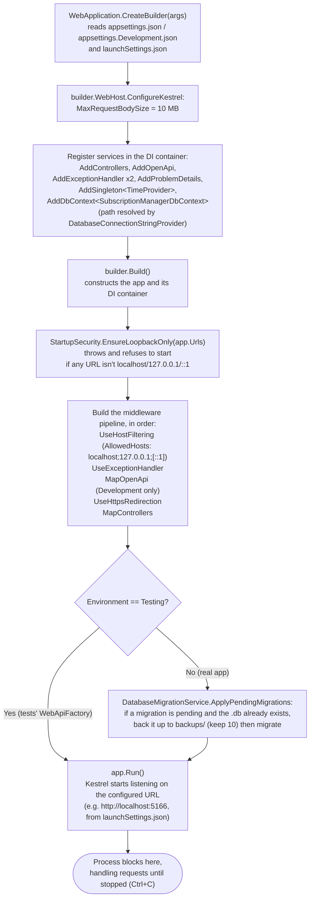
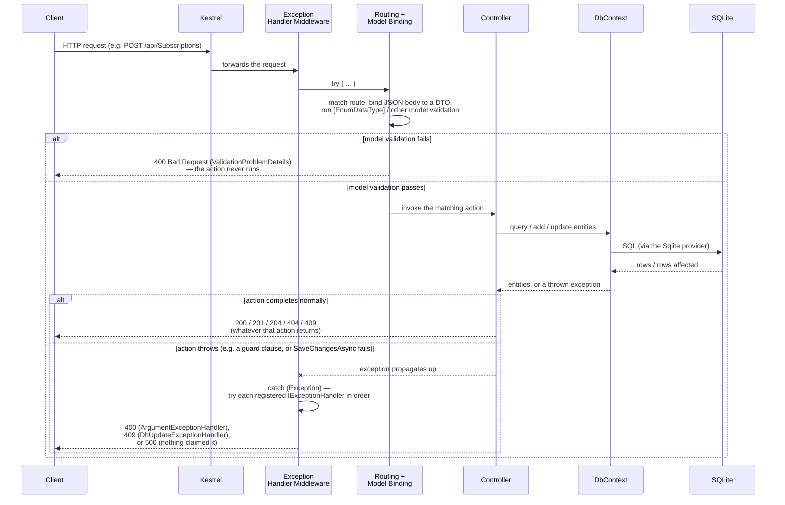

# 🏛️ Architecture & Request Lifecycle

🇬🇧 **English** | [🇪🇸 Español](./Architecture.es.md)

> How the backend starts up, how a request travels through it end to end, and what each file is responsible for. See [API Reference](../Api/Api.en.md) for endpoint contracts and [Database](../Database/Database.en.md) for the schema — this doc is about the plumbing that connects them.

---

## 📋 Table of Contents

1. [Startup Sequence](#-startup-sequence)
2. [Request Lifecycle](#-request-lifecycle)
3. [File Reference](#-file-reference)

---

## ▶️ Startup Sequence

Everything starts in `Program.cs`, which runs top to bottom as a sequence of statements (no `Main` method — this is a top-level-statements file):

A few things worth calling out:

- **Order matters.** `UseHostFiltering()` is the very first middleware of all — a request with a disallowed `Host` header gets rejected before anything else touches it. `UseExceptionHandler()` comes right after, wrapping every controller action in a try/catch at the middleware level — any unhandled exception thrown inside an action is caught here before it would otherwise crash the request. See [Request Lifecycle](#-request-lifecycle) below.
- **`AddDbContext` itself doesn't touch the database.** It only registers *how* to create a `SubscriptionManagerDbContext` — the default path (`%AppData%/SubscriptionManager/data.db`, or whatever's in `ConnectionStrings:DefaultConnection`) is computed beforehand, in `DatabaseConnectionStringProvider`, but the connection itself is still opened lazily, the first time something uses it.
- **The schema migrates itself on startup, except in tests.** `Program.cs` calls `DatabaseMigrationService.ApplyPendingMigrations` right before `app.Run()` — if a migration is pending, it backs up the existing `.db` file (if any) before applying it. This is skipped entirely when the environment is `"Testing"` (set by `WebApiFactory`), since the in-memory test database is created a different way, via `EnsureCreated()` — see [Database](../Database/Database.en.md) for the location and backup details.
- **This API has no authentication**, so two layers guard it from ever being reachable over the network: `StartupSecurity.EnsureLoopbackOnly` refuses to start if it's configured to listen on anything but loopback, and `UseHostFiltering()` (via the `AllowedHosts` key in `appsettings.json`) rejects with `400` any request whose `Host` header isn't `localhost`/`127.0.0.1`/`::1` — the standard defense against DNS-rebinding attacks from a browser tab.

---

## 🔁 Request Lifecycle

Once Kestrel is listening, here's what happens to one HTTP request, from the client to the database and back:

The two `IExceptionHandler`s and the controllers' own `TrySaveChangesAsync` helper make a more detailed version of this same decision — see the flowchart in the API Reference's [General Notes](../Api/Api.en.md#general-notes).

A `GET` follows the same shape without the "else action throws" branches doing much — there's no write to fail, so it's normally just routing → controller → `DbContext` (read-only, via `AsNoTracking()` where nothing gets mutated) → SQLite → response.

---

## 📂 File Reference

One paragraph per file (or tightly related group of files), organized the same way the folders are.

### `Program.cs`

Composes the application: configures Kestrel's upload limit, registers services (controllers, OpenAPI, the two exception handlers, a `TimeProvider`, the `DbContext`), checks it's only going to listen on loopback, builds the middleware pipeline, applies any pending migration (except in the `"Testing"` environment), then starts listening. See [Startup Sequence](#-startup-sequence) above — this is the only file in the project that runs unconditionally at process start.

### `Infrastructure/StartupSecurity.cs`

A single method, `EnsureLoopbackOnly`, called from `Program.cs` right after `builder.Build()`. It walks the configured URLs (`app.Urls`) and throws — preventing the app from starting — if any of them isn't `localhost`, `127.0.0.1`, or `::1`. This is the in-code guarantee that this unauthenticated API never accidentally listens on `0.0.0.0` or a real network IP.

### `Controllers/`

One controller per resource, each a thin layer that validates pre-conditions a `[EnumDataType]` attribute can't express (does a referenced id exist? is a name already taken?), delegates the actual business rule to the domain entity, and maps the result to an HTTP status code. None of them contain validation logic that belongs in `Domain/` — e.g. "price can't be negative" lives in `Subscription`, not here.

- **`CategoriesController`** — CRUD for `Categories`. `Create`/`Update` pre-check for a duplicate name, then save through `TrySaveChangesAsync` as a safety net against a race.
- **`SubscriptionsController`** — CRUD for `Subscriptions`, plus three sub-resources on the same route prefix: `PUT .../price` (delegates to `Subscription.ChangePrice`, also persists a `PriceHistory` row), `PUT .../status` (delegates to `Subscription.ChangeStatus`), and `GET .../upcoming` (loads active subscriptions, then calls `Subscription.GetNextRenewalDate` on each in memory — the renewal-date math isn't expressible as SQL EF Core could translate, so it has to run after the rows are already loaded).
- **`PriceHistoriesController`** — read-only `GET` (optionally filtered by `subscriptionId`) and `GET /{id}`. No `POST`/`PUT`/`DELETE`: records are only ever created as a side effect of `SubscriptionsController`'s price-change endpoint.
- **`ExpensesController`** — a single read-only `GET /summary`, aggregating every `Active` subscription's cost into a monthly/yearly total. Not a CRUD resource — it reports on `Subscriptions`.

### `DTO/`

Plain `record`s — the shapes that cross the HTTP boundary, kept deliberately separate from the domain entities so the API's public contract can evolve independently of the persistence model. Named `*Request` for request bodies and `*Response` for what a controller returns; `[EnumDataType]` on a `BillingCycle`/`SubscriptionStatus` property is the only validation attribute in use (see [General Notes](../Api/Api.en.md#general-notes) for what that rejects).

### `Domain/Entities/`

The business rules live here, not in the controllers — this is the one place in the codebase that's allowed to throw `ArgumentException`/`ArgumentOutOfRangeException` on invalid data.

- **`Category`** — just a name. `EnsureIsValid` rejects an empty/whitespace name on both construction and `Rename`.
- **`Subscription`** — the richest entity. Beyond construction and `UpdateDetails`, it owns three operations that are deliberately *not* exposed as plain property setters because each one has a rule attached: `ChangePrice` (returns a `PriceHistory` for the caller to persist — see below), `ChangeStatus` (rejects a no-op status change), and `GetNextRenewalDate` (pure date math, no side effects — see the flowchart in the [API Reference](../Api/Api.en.md#-subscriptions)).
- **`PriceHistory`** — an immutable record of one price change. Its constructor is the only way to create one (no setters, no `Update`), and it rejects a negative price or a "change" to the same price — which is also why `ChangePrice` on `Subscription` can't silently no-op.

All three have a private parameterless constructor solely for EF Core's materialization — application code can never construct an invalid one.

### `Domain/enum/`

`BillingCycle` (`Day`/`Monthly`/`Yearly`) and `SubscriptionStatus` (`Active`/`Paused`/`Cancelled`). Stored as plain integers in SQLite (see [Database: Enums Reference](../Database/Database.en.md#-enums-reference)) and validated at the API boundary via `[EnumDataType]` on the DTOs above — an undefined value never reaches these entities.

### `Infrastructure/ArgumentExceptionHandler.cs` & `DbUpdateExceptionHandler.cs`

The two `IExceptionHandler` implementations registered in `Program.cs` and invoked by the `UseExceptionHandler()` middleware — see [Request Lifecycle](#-request-lifecycle) above. `ArgumentExceptionHandler` claims anything thrown by the guard clauses in `Domain/Entities/` and maps it to `400`. `DbUpdateExceptionHandler` claims a `DbUpdateException` only when it's a genuine constraint violation (via `DbUpdateExceptionExtensions.IsConstraintViolation`, below) and maps it to `409` — anything else (e.g. a transient SQLite lock) is left to surface as `500`.

### `Infrastructure/Persistence/SubscriptionManagerDbContext.cs`

The EF Core `DbContext` — exposes the three `DbSet`s and wires up the Fluent API configurations below via `ApplyConfigurationsFromAssembly`. One instance is created per request (standard ASP.NET Core DI scoping) and injected into whichever controller needs it.

### `Infrastructure/Persistence/DbUpdateExceptionExtensions.cs` & `SubscriptionManagerDbContextExtensions.cs`

Two small extension-method helpers shared between the controllers and `DbUpdateExceptionHandler`, so "what counts as a real database conflict" is defined exactly once: `IsConstraintViolation()` inspects a `DbUpdateException`'s inner `SqliteException` for error code `19` (`SQLITE_CONSTRAINT`); `TrySaveChangesAsync()` wraps `SaveChangesAsync()` in a `catch` filtered by that same check, returning `false` only on a genuine constraint violation — anything else isn't caught at all, so it propagates up to `DbUpdateExceptionHandler`, which also won't claim it, ending in a genuine `500`.

### `Infrastructure/Persistence/DatabaseConnectionStringProvider.cs`

Computes the connection string `Program.cs` uses to register the `DbContext`: if `ConnectionStrings:DefaultConnection` is empty in `appsettings.json`, it builds the default path under the user's application data folder (`%AppData%/SubscriptionManager/data.db`) and creates the directory if needed; if a value is configured, it's returned as-is, untouched.

### `Infrastructure/Persistence/DatabaseMigrationService.cs`

Called by `Program.cs` right before `app.Run()` (except in the `"Testing"` environment). If `context.Database.GetPendingMigrations()` isn't empty, it copies the existing `.db` file into a `backups/` folder next to it (timestamped, using the injected `TimeProvider`) before applying the migrations, and deletes any backup beyond the 10 most recent. If the `.db` file doesn't exist yet (first run) or nothing is pending, it skips the backup — it either just migrates, or does nothing at all.

### `Infrastructure/Persistence/Configurations/*.cs`

One `IEntityTypeConfiguration<T>` per entity — the Fluent API equivalent of data annotations, used instead of attributes so `Domain/Entities/` stays free of persistence concerns. This is where column lengths, the `NOCASE` collation behind case-insensitive uniqueness, the unique indexes, decimal precision, and the two `OnDelete` behaviors (`RESTRICT` for `Category → Subscription`, `CASCADE` for `Subscription → PriceHistory`) are all declared — see [Database: Relationships](../Database/Database.en.md#-relationships) for why each one was chosen.

### `Migrations/`

Generated by `dotnet ef migrations add` — never hand-edited. Each pair of `*.cs`/`*.Designer.cs` files is one schema change; they apply themselves when the real app starts, via `DatabaseMigrationService` (above) — `dotnet ef database update` is no longer needed by hand unless you want to apply them without starting the API. `SubscriptionManagerDbContextModelSnapshot.cs` is EF Core's record of the resulting schema, used to compute the next migration's diff.

---

Last updated: 2026-11-21

