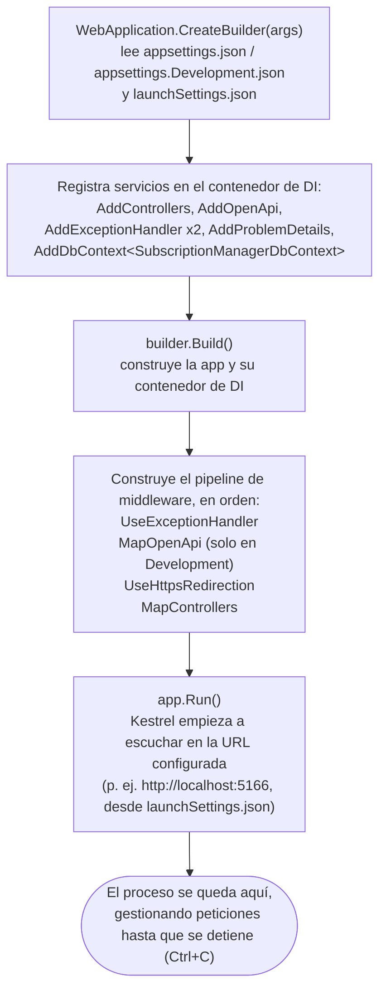
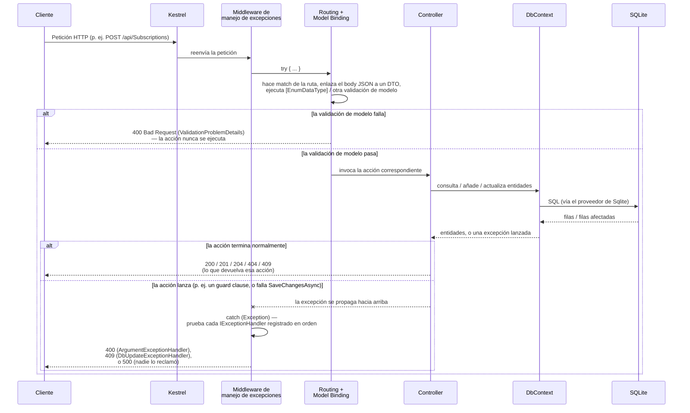

# 🏛️ Arquitectura y Ciclo de Vida de una Petición

[🇬🇧 English](./Architecture.en.md) | 🇪🇸 **Español**

> Cómo arranca el backend, cómo viaja una petición de principio a fin, y de qué es responsable cada fichero. Ver la [Referencia de la API](../Api/Api.es.md) para los contratos de cada endpoint y [Base de Datos](../Database/Database.es.md) para el esquema — este doc trata sobre la fontanería que los conecta.

---

## 📋 Índice

1. [Secuencia de arranque](#-secuencia-de-arranque)
2. [Ciclo de vida de una petición](#-ciclo-de-vida-de-una-petición)
3. [Referencia por fichero](#-referencia-por-fichero)

---

## ▶️ Secuencia de arranque

Todo empieza en `Program.cs`, que se ejecuta de arriba a abajo como una secuencia de instrucciones (no hay un método `Main` — es un fichero de top-level statements):

Un par de cosas que merece la pena resaltar:

- **El orden importa.** `UseExceptionHandler()` se registra *antes* que `MapControllers()`, así que envuelve cada acción del controller en un try/catch a nivel de middleware — cualquier excepción sin capturar lanzada dentro de una acción se atrapa aquí antes de que, si no, tumbara la petición. Ver [Ciclo de vida de una petición](#-ciclo-de-vida-de-una-petición) más abajo.
- **`AddDbContext` no toca la base de datos al arrancar.** Solo registra *cómo* crear un `SubscriptionManagerDbContext` (apuntando al fichero SQLite nombrado en `ConnectionStrings:DefaultConnection` de `appsettings.json`) — la conexión se abre de forma perezosa, la primera vez que una petición la usa.
- **Sin configuración manual del esquema.** El esquema del fichero SQLite viene por completo de las migraciones de EF Core en `Migrations/`, aplicadas por adelantado vía `dotnet ef database update` (ver la [Guía de Pruebas](../Testing/Testing.es.md)) — `Program.cs` nunca llama a nada como `EnsureCreated()` contra la base de datos real.

---

## 🔁 Ciclo de vida de una petición

Una vez Kestrel está escuchando, esto es lo que le pasa a una petición HTTP, desde el cliente hasta la base de datos y vuelta:

Los dos `IExceptionHandler` y el helper `TrySaveChangesAsync` de los controllers son una versión más detallada de esta misma decisión — ver el diagrama de flujo en las [Notas generales](../Api/Api.es.md#notas-generales) de la Referencia de la API.

Un `GET` sigue la misma forma sin que las ramas "la acción lanza" hagan gran cosa — no hay ninguna escritura que pueda fallar, así que normalmente es solo routing → controller → `DbContext` (de solo lectura, vía `AsNoTracking()` donde no se muta nada) → SQLite → respuesta.

---

## 📂 Referencia por fichero

Un párrafo por fichero (o por grupo de ficheros muy relacionados), organizados igual que las carpetas.

### `Program.cs`

Compone la aplicación: registra servicios (controllers, OpenAPI, los dos manejadores de excepciones, el `DbContext`) y construye el pipeline de middleware, luego empieza a escuchar. Ver [Secuencia de arranque](#-secuencia-de-arranque) arriba — es el único fichero del proyecto que se ejecuta incondicionalmente al arrancar el proceso.

### `Controllers/`

Un controller por recurso, cada uno una capa fina que valida precondiciones que un atributo `[EnumDataType]` no puede expresar (¿existe el id referenciado? ¿ya está usado ese nombre?), delega la regla de negocio real a la entidad de dominio, y traduce el resultado a un código de estado HTTP. Ninguno contiene lógica de validación que pertenezca a `Domain/` — p. ej. "el precio no puede ser negativo" vive en `Subscription`, no aquí.

- **`CategoriesController`** — CRUD de `Categories`. `Create`/`Update` comprueban primero si el nombre ya existe, y luego guardan vía `TrySaveChangesAsync` como red de seguridad ante una carrera.
- **`SubscriptionsController`** — CRUD de `Subscriptions`, más tres sub-recursos en el mismo prefijo de ruta: `PUT .../price` (delega en `Subscription.ChangePrice`, y además persiste una fila de `PriceHistory`), `PUT .../status` (delega en `Subscription.ChangeStatus`), y `GET .../upcoming` (carga las suscripciones activas y luego llama a `Subscription.GetNextRenewalDate` sobre cada una en memoria — el cálculo de la fecha de renovación no es expresable como SQL que EF Core pueda traducir, así que tiene que ejecutarse una vez las filas ya están cargadas).
- **`PriceHistoriesController`** — `GET` de solo lectura (opcionalmente filtrado por `subscriptionId`) y `GET /{id}`. Sin `POST`/`PUT`/`DELETE`: los registros solo se crean como efecto secundario del endpoint de cambio de precio de `SubscriptionsController`.
- **`ExpensesController`** — un único `GET /summary` de solo lectura, que agrega el coste de cada suscripción `Active` en un total mensual/anual. No es un recurso CRUD propio — informa sobre `Subscriptions`.

### `DTO/`

`record`s simples — las formas que cruzan la frontera HTTP, mantenidas deliberadamente separadas de las entidades de dominio para que el contrato público de la API pueda evolucionar sin depender del modelo de persistencia. Nombrados `*Request` para los cuerpos de petición y `*Response` para lo que devuelve un controller; `[EnumDataType]` sobre una propiedad `BillingCycle`/`SubscriptionStatus` es el único atributo de validación en uso (ver [Notas generales](../Api/Api.es.md#notas-generales) para qué rechaza exactamente).

### `Domain/Entities/`

Las reglas de negocio viven aquí, no en los controllers — es el único sitio del código al que se le permite lanzar `ArgumentException`/`ArgumentOutOfRangeException` ante datos inválidos.

- **`Category`** — solo un nombre. `EnsureIsValid` rechaza un nombre vacío/en blanco tanto en la construcción como en `Rename`.
- **`Subscription`** — la entidad más rica. Más allá de la construcción y `UpdateDetails`, posee tres operaciones que deliberadamente *no* se exponen como simples setters de propiedad porque cada una tiene una regla asociada: `ChangePrice` (devuelve un `PriceHistory` para que quien la llame lo persista — ver abajo), `ChangeStatus` (rechaza un cambio de estado al mismo valor), y `GetNextRenewalDate` (cálculo de fechas puro, sin efectos secundarios — ver el diagrama de flujo en la [Referencia de la API](../Api/Api.es.md#-subscriptions)).
- **`PriceHistory`** — un registro inmutable de un cambio de precio. Su constructor es la única forma de crear uno (sin setters, sin `Update`), y rechaza un precio negativo o un "cambio" al mismo precio — razón por la cual `ChangePrice` en `Subscription` no puede quedarse en silencio sin hacer nada.

Las tres tienen un constructor privado sin parámetros solo para que EF Core las materialice — el código de la aplicación nunca puede construir una inválida.

### `Domain/enum/`

`BillingCycle` (`Day`/`Monthly`/`Yearly`) y `SubscriptionStatus` (`Active`/`Paused`/`Cancelled`). Se guardan como enteros simples en SQLite (ver [Base de Datos: Referencia de enums](../Database/Database.es.md#-referencia-de-enums)) y se validan en la frontera de la API vía `[EnumDataType]` sobre los DTOs de arriba — un valor no definido nunca llega a estas entidades.

### `Infrastructure/ArgumentExceptionHandler.cs` y `DbUpdateExceptionHandler.cs`

Los dos `IExceptionHandler` registrados en `Program.cs` e invocados por el middleware `UseExceptionHandler()` — ver [Ciclo de vida de una petición](#-ciclo-de-vida-de-una-petición) arriba. `ArgumentExceptionHandler` reclama cualquier cosa lanzada por los guard clauses de `Domain/Entities/` y la traduce a `400`. `DbUpdateExceptionHandler` reclama una `DbUpdateException` solo cuando es una violación de restricción genuina (vía `DbUpdateExceptionExtensions.IsConstraintViolation`, abajo) y la traduce a `409` — cualquier otra cosa (p. ej. un bloqueo transitorio de SQLite) se deja salir como `500`.

### `Infrastructure/Persistence/SubscriptionManagerDbContext.cs`

El `DbContext` de EF Core — expone los tres `DbSet` y conecta las configuraciones Fluent API de abajo vía `ApplyConfigurationsFromAssembly`. Se crea una instancia por petición (el scoping estándar de DI de ASP.NET Core) y se inyecta en el controller que la necesite.

### `Infrastructure/Persistence/DbUpdateExceptionExtensions.cs` y `SubscriptionManagerDbContextExtensions.cs`

Dos pequeños helpers de métodos de extensión compartidos entre los controllers y `DbUpdateExceptionHandler`, así que "qué cuenta como un conflicto real de base de datos" se define exactamente una vez: `IsConstraintViolation()` inspecciona la `SqliteException` interna de una `DbUpdateException` buscando el código de error `19` (`SQLITE_CONSTRAINT`); `TrySaveChangesAsync()` envuelve `SaveChangesAsync()` en un `catch` filtrado por esa misma comprobación, devolviendo `false` solo ante una violación de restricción genuina — cualquier otra cosa no se captura en absoluto, así que se propaga hasta `DbUpdateExceptionHandler`, que tampoco la reclamará, terminando en un `500` genuino.

### `Infrastructure/Persistence/Configurations/*.cs`

Un `IEntityTypeConfiguration<T>` por entidad — el equivalente de Fluent API a las data annotations, usado en vez de atributos para que `Domain/Entities/` se mantenga libre de preocupaciones de persistencia. Aquí es donde se declaran las longitudes de columna, la colación `NOCASE` detrás de la unicidad sin distinguir mayúsculas, los índices únicos, la precisión decimal, y los dos comportamientos `OnDelete` (`RESTRICT` para `Category → Subscription`, `CASCADE` para `Subscription → PriceHistory`) — ver [Base de Datos: Relaciones](../Database/Database.es.md#-relaciones) para por qué se elegió cada uno.

### `Migrations/`

Generados por `dotnet ef migrations add` — nunca editados a mano. Cada par de ficheros `*.cs`/`*.Designer.cs` es un cambio de esquema aplicado en orden por `dotnet ef database update`; `SubscriptionManagerDbContextModelSnapshot.cs` es el registro de EF Core del esquema resultante, usado para calcular el diff de la siguiente migración.

---

Última actualización: 2026-11-15

