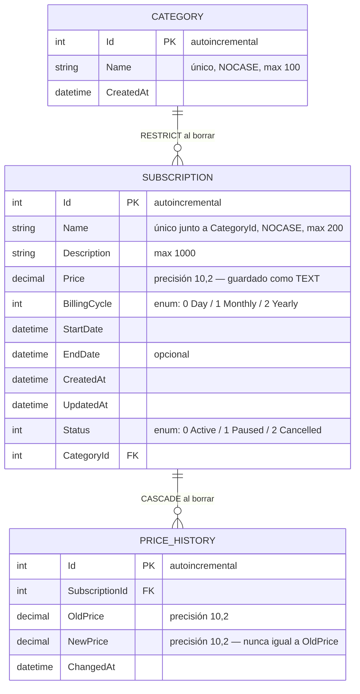

# 🔬 Guía de Código — Backend y Base de Datos

> Referencia exhaustiva, para programador, de **todo** el código del backend, método a método y a menudo línea a línea. Distinta de [`Concepts.md`](../Concepts/Concepts.es.md) (introducción conceptual, para quien no lee código) y de [`Architecture.md`](../Architecture/Architecture.es.md) (diagramas de alto nivel, sin entrar en el cuerpo de cada método). Aquí se explica **qué hace cada línea y por qué**. Solo backend + base de datos; el frontend se documenta así cuando empiece la Fase 8.
>
> Estado del código documentado: el de después del sub-paso 4 de la Fase 0 (2026-11-21) — ver el [Roadmap](../Roadmap/Roadmap.es.md). Si el código cambia y esto no, confía en el código: cada fase nueva trae su actualización correspondiente a esta guía.

## 🧩 Cómo funciona todo junto

Esta sección es el relato unificado: cómo interactúan **todas** las piezas a la vez, en vez de pieza por pieza. Los ficheros de detalle (más abajo) explican el "qué hace cada línea de este fichero concreto"; esta sección explica el "cómo se conecta esto con todo lo demás". Todo el SQL que aparece aquí es **real**, capturado ejecutando la app de verdad (con el logging de EF Core que ya viene activado por defecto en `appsettings.json`), no una aproximación de memoria.

### A) Una petición real, de principio a fin

**Caso 1 — crear una categoría, y luego una suscripción dentro de ella.**

Petición: `POST /api/Categories` con `{"name":"Streaming"}`.

1. Llega a Kestrel, pasa `UseHostFiltering()` (la cabecera `Host` es `127.0.0.1`, está permitida), entra en el `try` de `UseExceptionHandler()`, el enrutador hace *match* con `CategoriesController.Create`.
2. `[ApiController]` deserializa el cuerpo JSON a un `CategoryRequest { Name = "Streaming" }` — no hay ningún atributo de validación en este DTO, así que llega sin más comprobación a la acción.
3. Dentro de `Create`, la primera línea (`dbContext.Categories.AnyAsync(c => c.Name == request.Name)`) es la primera vez que se toca la base de datos en esta petición. En ese instante, EF Core traduce la expresión LINQ a SQL y la ejecuta — **no antes**. La consulta real capturada:
   ```sql
   SELECT EXISTS (
       SELECT 1
       FROM "Categories" AS "c"
       WHERE "c"."Name" = @request_Name)
   ```
   Nótese que EF Core no hizo un `SELECT *` ni trajo filas: tradujo directamente la intención ("¿existe alguna?") al `EXISTS` de SQL, que SQLite puede resolver sin ni siquiera leer una fila completa.
4. No existe ninguna → `new Category("Streaming")` (constructor del dominio, valida, asigna `CreatedAt`) → `dbContext.Categories.Add(category)` marca la entidad como `Added` en el *change tracker*, **todavía sin tocar la base de datos**.
5. `TrySaveChangesAsync()` llama a `SaveChangesAsync()`, que es quien de verdad genera y ejecuta el SQL:
   ```sql
   INSERT INTO "Categories" ("CreatedAt", "Name")
   VALUES (@p0, @p1)
   RETURNING "Id";
   ```
   El `RETURNING "Id"` es la forma en que el proveedor de SQLite de EF Core recupera, en la misma instrucción, el id autoincremental que acaba de generar SQLite — y EF Core lo escribe automáticamente en `category.Id` (la propiedad C#), sin que el código de este proyecto tenga que pedirlo aparte.
6. `CreatedAtAction(...)` construye la respuesta `201`. Cuerpo real devuelto: `{"id":1,"name":"Streaming","createdAt":"2026-11-21T06:46:31.103241Z"}`.

Ahora, `POST /api/Subscriptions` con `{"name":"Netflix","description":"","price":14.99,"billingCycle":1,"startDate":"2026-11-21","categoryId":1}`:

1. `[EnumDataType(typeof(BillingCycle))]` sobre `BillingCycle` en `SubscriptionCreateRequest` ya comprobó, **antes de que la acción se ejecute siquiera**, que `1` es un valor válido del enum (`Monthly`). Si hubiera sido `99`, la acción no se habría llegado a llamar — ASP.NET Core habría respondido `400` él solo.
2. `dbContext.Categories.FindAsync(request.CategoryId)` — primera consulta real:
   ```sql
   SELECT "c"."Id", "c"."CreatedAt", "c"."Name"
   FROM "Categories" AS "c"
   WHERE "c"."Id" = @p
   LIMIT 1
   ```
   (`FindAsync` sí mira primero el *change tracker* en memoria por si esa entidad ya estuviera cargada en esta misma petición — aquí no lo estaba, así que fue a la base de datos.)
3. Comprobación de nombre duplicado **dentro de esa categoría**:
   ```sql
   SELECT EXISTS (
       SELECT 1
       FROM "Subscriptions" AS "s"
       WHERE "s"."Name" = @request_Name AND "s"."CategoryId" = @request_CategoryId)
   ```
4. `new Subscription(...)` + `Add(...)` + `TrySaveChangesAsync()` → una única instrucción, con **las diez columnas a la vez**:
   ```sql
   INSERT INTO "Subscriptions" ("BillingCycle", "CategoryId", "CreatedAt", "Description", "EndDate", "Name", "Price", "StartDate", "Status", "UpdatedAt")
   VALUES (@p0, @p1, @p2, @p3, @p4, @p5, @p6, @p7, @p8, @p9)
   RETURNING "Id";
   ```
5. Repitiendo la misma petición exacta una segunda vez, la comprobación del paso 3 esta vez devuelve `true`, y el controller responde directamente `409` con `"A subscription named 'Netflix' already exists in this category."` — **sin llegar siquiera a intentar el `INSERT`**. Este es el camino de "lo detecté yo antes de guardar". El otro camino — "lo detectó la base de datos al guardar, por una carrera de verdad entre dos peticiones simultáneas" — es el que cubre `TrySaveChangesAsync` (ver [Persistence.es.md](./Persistence.es.md)); con una sola petición de curl secuencial, como aquí, no se puede provocar ese segundo camino, pero el código que lo maneja es el mismo `if (!await dbContext.TrySaveChangesAsync())` en los dos casos.

**Caso 2 — cambiar el precio de esa suscripción** (`PUT /api/Subscriptions/1/price` con `{"newPrice":16.99}`):

1. `FindAsync(1)` sobre `Subscriptions` — trae la entidad completa (las once columnas), y esta vez **sí** queda bajo seguimiento del *change tracker* (no se usó `AsNoTracking()`), porque hace falta para el paso siguiente.
2. `subscription.ChangePrice(16.99)` — código C# puro, sin SQL todavía: crea el `PriceHistory` (con el precio viejo `14.99` y el nuevo `16.99`), y pone `subscription.Price = 16.99`. En este instante, el *change tracker* ya sabe, por comparación interna, que esa propiedad cambió.
3. `dbContext.PriceHistories.Add(priceHistory)` + un único `SaveChangesAsync()` — y aquí está lo más revelador de cómo funciona EF Core: **una sola llamada a `SaveChangesAsync()` generó dos instrucciones SQL distintas**, una por cada entidad que había cambiado, ejecutadas las dos dentro de la misma transacción implícita:
   ```sql
   INSERT INTO "PriceHistories" ("ChangedAt", "NewPrice", "OldPrice", "SubscriptionId")
   VALUES (@p0, @p1, @p2, @p3)
   RETURNING "Id";

   UPDATE "Subscriptions" SET "Price" = @p0, "UpdatedAt" = @p1
   WHERE "Id" = @p2
   RETURNING 1;
   ```
   Nótese que el `UPDATE` **solo** toca `Price` y `UpdatedAt` — las únicas dos columnas que de verdad cambiaron. EF Core no regenera la fila entera; el *change tracker* sabe exactamente qué propiedades se modificaron desde que se cargó la entidad, y genera el `UPDATE` mínimo necesario. Si la petición fallara a mitad (por ejemplo, un corte de luz entre las dos instrucciones), SQLite revierte la transacción entera — nunca quedaría el `PriceHistory` creado sin el precio actualizado, o viceversa.

**Caso 3 — consultar lo que vence pronto** (`GET /api/Subscriptions/upcoming`):

Una única consulta SQL, capturada tal cual:
```sql
SELECT "s"."Id", "s"."BillingCycle", "s"."CategoryId", "s"."CreatedAt", "s"."Description", "s"."EndDate", "s"."Name", "s"."Price", "s"."StartDate", "s"."Status", "s"."UpdatedAt"
FROM "Subscriptions" AS "s"
WHERE "s"."Status" = 0
```
Esto confirma, con evidencia real, lo que se explica en [Controllers.es.md](./Controllers.es.md#getupcomingfromquery-int-withindays--30--get-apisubscriptionsupcoming): **no hay ningún filtro de fecha en el SQL**. SQLite solo filtra por `Status = 0` (es decir, `Active`) y devuelve esas filas completas. Todo lo demás — calcular la próxima fecha de renovación de cada una, descartar las que caen fuera de la ventana pedida, ordenarlas — pasa **después**, en C#, sobre la lista ya en memoria, porque `GetNextRenewalDate()` no es traducible a SQL.

### B) Cómo funciona EF Core, como sistema completo

Con los tres casos de arriba ya vistos con SQL real, las piezas sueltas de EF Core cobran sentido como un único mecanismo:

- **El `DbContext` es, a la vez, una unidad de trabajo y un catálogo de lo que está pasando.** Vive una sola instancia por petición HTTP (registrado como `Scoped` en `Program.cs`). Dentro, mantiene el ***change tracker***: por cada entidad que se carga desde una consulta, o que se añade con `.Add(...)`, EF Core guarda una copia "tal y como estaba" y vigila la actual, asignándole un estado: `Added` (nueva, falta el `INSERT`), `Unchanged` (igual que cuando se cargó), `Modified` (alguna propiedad cambió, falta el `UPDATE`), `Deleted` (marcada con `.Remove()`, falta el `DELETE`), o `Detached` (no se está vigilando — lo que consigue `AsNoTracking()`, o una entidad que nunca pasó por el `DbContext`).
- **Las consultas LINQ no se ejecutan al escribirlas, sino al enumerarlas.** `dbContext.Categories.Where(...)` por sí solo no toca la base de datos — es una "receta" (`IQueryable`, un árbol de expresión en memoria). Solo al llamar a algo que de verdad necesita el resultado (`ToListAsync()`, `FirstOrDefaultAsync()`, `AnyAsync()`, o simplemente recorrer con `foreach`) EF Core traduce ese árbol de expresión a texto SQL y lo manda a SQLite — esto se llama **ejecución diferida**, y es por lo que, en los controllers de este proyecto, se puede ir añadiendo `.Where(...)` condicionalmente (ver `PriceHistoriesController.Get`) antes de ejecutar nada.
- **`SaveChangesAsync()` es el único punto donde se escribe de verdad.** Cuando se llama, EF Core recorre el *change tracker* completo, calcula **el conjunto mínimo** de instrucciones `INSERT`/`UPDATE`/`DELETE` necesarias (una por cada entidad `Added`/`Modified`/`Deleted`, respetando el orden correcto según las claves foráneas — p. ej. no puede insertar una `Subscription` antes de que su `Category` ya tenga un `Id` real), y las ejecuta todas dentro de **una única transacción implícita** — como se vio en el Caso 2 de arriba, con dos tablas a la vez. Si cualquiera de las instrucciones falla, ninguna de las demás queda aplicada.
- **Los valores generados por la base de datos (como el `Id` autoincremental) se devuelven y se escriben solos en el objeto C#.** El `RETURNING "Id"` visto en cada `INSERT` es la forma concreta en que esto pasa aquí: en el mismo viaje de ida y vuelta a SQLite, sin una segunda consulta aparte.
- **Las migraciones son lo que mantiene sincronizado el modelo C# con el esquema real.** Todo lo anterior — el *change tracker*, la traducción de LINQ, el `SaveChangesAsync` — asume que las tablas de la base de datos tienen exactamente las columnas que las clases de `Domain/Entities/` y las configuraciones de `Infrastructure/Persistence/Configurations/` describen. Esa sincronización la garantizan las migraciones (ver [Persistence.es.md](./Persistence.es.md#migrations)), aplicadas automáticamente al arrancar por `DatabaseMigrationService`.
- **La conexión a SQLite se abre y cierra solo, por detrás.** No hay ningún `connection.Open()` en el código de este proyecto — el `DbContext` abre la conexión la primera vez que hace falta ejecutar algo contra la base de datos, y la libera cuando el `DbContext` se destruye (al final de la petición HTTP, cuando el ámbito `Scoped` se cierra).

### C) Cómo funciona la base de datos, como sistema completo

Las tres tablas, todas sus columnas, relaciones e índices, en una sola vista — en vez de repartido migración a migración y configuración a configuración:



Y, en una sola tabla, **todas** las restricciones reales del esquema, de dónde viene cada una en el código, y qué pasa si se viola:

| Restricción | De dónde viene (Fluent API) | Qué pasa si se viola |
|---|---|---|
| `Categories.Name` único, sin distinguir mayúsculas | `CategoryConfiguration`: `.UseCollation("NOCASE")` + `.HasIndex(...).IsUnique()` | SQLite devuelve `SQLITE_CONSTRAINT` → `DbUpdateException` → `409` (vía `DbUpdateExceptionHandler` o `TrySaveChangesAsync`, según cuándo se detecte) |
| `(Subscriptions.Name, Subscriptions.CategoryId)` único compuesto, sin distinguir mayúsculas | `SubscriptionConfiguration`: `.UseCollation("NOCASE")` en `Name` + `.HasIndex(s => new { s.Name, s.CategoryId }).IsUnique()` | Igual que arriba — `409` |
| `Subscriptions.CategoryId` → `Categories.Id`, `RESTRICT` | `SubscriptionConfiguration`: `.OnDelete(DeleteBehavior.Restrict)` | Borrar una categoría con suscripciones falla con `SQLITE_CONSTRAINT` → `409` |
| `PriceHistories.SubscriptionId` → `Subscriptions.Id`, `CASCADE` | `PriceHistoryConfiguration`: `.OnDelete(DeleteBehavior.Cascade)` | Borrar una suscripción borra automáticamente su historial — nunca falla por esto |
| `Price`/`OldPrice`/`NewPrice` con precisión `(10,2)` | `.HasPrecision(10, 2)` en las tres configuraciones | No es una restricción que la base de datos rechace — es solo cómo EF Core serializa el `decimal` a `TEXT`; un valor con más decimales se trunca al guardar |
| `Name` con longitud máxima (100/200) y `Description` (1000) | `.HasMaxLength(...)` en las configuraciones | Documental en el esquema; SQLite, a diferencia de otros motores, no corta ni rechaza un texto más largo por sí solo — es una convención del proyecto, no una barrera dura |

Todas estas restricciones viven **solo** en las clases `*Configuration.cs` (Fluent API) — las entidades de `Domain/Entities/` no saben que ninguna de ellas existe, por diseño (ver [Concepts.md § Entity Framework Core](../Concepts/Concepts.es.md#-entity-framework-core-qué-es-un-orm)).

---

## 📂 Mapa de ficheros y dónde se explica cada uno

| Carpeta/fichero | Dónde se explica |
|---|---|
| `Program.cs` | Este documento, más abajo |
| `Domain/Entities/*.cs`, `Domain/enum/*.cs` | [Domain.es.md](./Domain.es.md) |
| `DTO/*.cs` | [Dtos.es.md](./Dtos.es.md) |
| `Infrastructure/*.cs` (manejadores de excepciones, `StartupSecurity`) | [Infrastructure.es.md](./Infrastructure.es.md) |
| `Infrastructure/Persistence/**/*.cs`, `Migrations/*.cs` | [Persistence.es.md](./Persistence.es.md) |
| `Controllers/*.cs` | [Controllers.es.md](./Controllers.es.md) |
| `backend/tests/**/*.cs` | Cubierto en detalle por capacidad (no línea a línea) en la [Guía de Pruebas](../Testing/Testing.es.md); aquí solo se explica `WebApiFactory.cs`, porque es infraestructura de producción simulada, no un test en sí — ver el final de este documento. |

---

## 🧵 `Program.cs`, línea a línea

Este es el único fichero que se ejecuta **siempre**, de arriba a abajo, al arrancar el proceso — no tiene una clase `Program` explícita ni un método `Main`: es un fichero de **top-level statements** (una característica de C# que convierte el cuerpo del fichero entero en el `Main` implícito del programa). Contenido completo, comentado tramo a tramo:

```csharp
var builder = WebApplication.CreateBuilder(args);
```
Crea el **constructor de la aplicación**. Por debajo, esto ya hace bastante: lee `appsettings.json`, luego `appsettings.{Environment}.json` (p. ej. `appsettings.Development.json`, que no está en el repo — ver `.gitignore` — y puede no existir), después las variables de entorno, y por último los argumentos de la línea de comandos (`args`) — cada fuente posterior puede sobreescribir a la anterior. También prepara ya el registro de logging por consola que se ve en la terminal al arrancar.

```csharp
builder.WebHost.ConfigureKestrel(options =>
{
    options.Limits.MaxRequestBodySize = 10 * 1024 * 1024; // 10 MB upload limit.
});
```
**Kestrel** es el servidor HTTP que trae .NET integrado (el que realmente abre el socket y entiende HTTP). `ConfigureKestrel` permite tocar sus opciones antes de que arranque. Aquí se fija el tamaño máximo de cualquier cuerpo de petición en 10 MB — si alguien manda una petición más grande, Kestrel la corta con un error antes de que llegue a ningún controller. Hoy no hay ningún endpoint que reciba ficheros, pero esto ya queda listo para el importador de extractos bancarios de la Fase 4.

```csharp
builder.Services.AddControllers();
```
`builder.Services` es el **contenedor de inyección de dependencias** (ver [Concepts.md § Inyección de dependencias](../Concepts/Concepts.es.md#-inyección-de-dependencias-quién-construye-qué) para el concepto). `AddControllers()` registra todo lo que ASP.NET Core necesita para descubrir las clases marcadas `[ApiController]`, enlazar el JSON de la petición a los parámetros de cada acción, y serializar lo que devuelvan de vuelta a JSON.

```csharp
builder.Services.AddOpenApi();
```
Registra el generador del documento OpenAPI (la descripción máquina-legible de la API — ver el endpoint `/openapi/v1.json` cuando está en desarrollo). No tiene nada que ver con inteligencia artificial, a pesar del nombre parecido a "OpenAI".

```csharp
builder.Services.AddExceptionHandler<ArgumentExceptionHandler>();
builder.Services.AddExceptionHandler<DbUpdateExceptionHandler>();
builder.Services.AddProblemDetails();
```
Registra los dos manejadores de excepciones (detallados en [Infrastructure.es.md](./Infrastructure.es.md)) en el orden en que se probarán cuando algo lance una excepción sin capturar. `AddProblemDetails()` activa el formato de error estándar [RFC 7807](https://www.rfc-editor.org/rfc/rfc7807) (`{ "status": ..., "title": ..., "detail": ... }`) como forma por defecto de reportar errores — incluidos los que no reclama ningún `IExceptionHandler` registrado (acaban en un `500` con este mismo formato).

```csharp
builder.Services.AddSingleton(TimeProvider.System);
```
Registra `TimeProvider.System` (el reloj real del sistema) como instancia única (`Singleton` — una sola instancia compartida por toda la vida de la app, en vez de una nueva por petición). Cualquier clase que, en su constructor, pida un `TimeProvider`, recibirá esta. En los tests, se sustituye por uno falso (ver [Concepts.md § TimeProvider](../Concepts/Concepts.es.md#-timeprovider-por-qué-no-usar-datetimenow-directamente)).

> **Nota de estado**: a día de hoy, este `TimeProvider` solo lo usa `DatabaseMigrationService` (para la marca de tiempo de las copias de seguridad). El resto del dominio (`Subscription.GetNextRenewalDate`, etc.) todavía llama a `DateTime.UtcNow` directamente — eso es precisamente lo que queda pendiente en el próximo sub-paso de la Fase 0 ("`TimeProvider` en toda la lógica que use 'hoy'").

```csharp
var connectionString = DatabaseConnectionStringProvider.Resolve(
    builder.Configuration.GetConnectionString("DefaultConnection"));
```
Lee la clave `ConnectionStrings:DefaultConnection` de la configuración (hoy, una cadena vacía en `appsettings.json`) y se la pasa a `DatabaseConnectionStringProvider.Resolve` (detallado en [Persistence.es.md](./Persistence.es.md)), que calcula la ruta real: si está vacía, construye `%AppData%/SubscriptionManager/data.db`; si no, usa la que haya, tal cual.

```csharp
builder.Services.AddDbContext<SubscriptionManagerDbContext>(options =>
    options.UseSqlite(connectionString));
```
Registra **cómo** construir un `SubscriptionManagerDbContext` cuando algo lo necesite — con ámbito `Scoped` por defecto (una instancia nueva por petición HTTP; es el comportamiento implícito de `AddDbContext`, no hace falta pedirlo explícitamente). `UseSqlite(connectionString)` le dice a EF Core qué proveedor de base de datos usar y con qué cadena de conexión. **Esto no abre ninguna conexión todavía** — solo queda "apuntado" para cuando se use.

```csharp
var app = builder.Build();
```
Construye la aplicación de verdad: resuelve todo el grafo de dependencias registradas y arma el contenedor final. A partir de aquí, `builder` ya no se usa — todo lo que viene usa `app`.

```csharp
StartupSecurity.EnsureLoopbackOnly(app.Urls);
```
Comprobación de seguridad, en bloque, antes de montar el pipeline: `app.Urls` es la lista de URLs en las que la app está a punto de escuchar (viene de `launchSettings.json` en desarrollo, o de la variable de entorno `ASPNETCORE_URLS` en producción). Si alguna no es `localhost`/`127.0.0.1`/`::1`, este método **lanza una excepción** — y el programa se para ahí mismo, sin llegar a escuchar nada. Detalle completo en [Infrastructure.es.md](./Infrastructure.es.md).

```csharp
app.UseHostFiltering();
app.UseExceptionHandler();
```
Las dos primeras piezas del pipeline de middleware. `UseHostFiltering()` es una pieza **integrada en ASP.NET Core** (no escrita en este proyecto) que lee la clave `AllowedHosts` de la configuración (hoy, `"localhost;127.0.0.1;[::1]"`) y devuelve `400` a cualquier petición cuya cabecera `Host` no encaje con ninguna de ellas — antes de que nada más la toque. `UseExceptionHandler()` va justo después: envuelve todo lo que viene después en un `try/catch` a nivel de middleware.

```csharp
if (app.Environment.IsDevelopment())
{
    app.MapOpenApi();
}
```
Solo en desarrollo, expone el documento OpenAPI generado antes (`AddOpenApi()`) en la ruta `/openapi/v1.json`. En producción, esta rama ni se ejecuta — no hace falta exponer el "mapa" de la API fuera de desarrollo.

```csharp
app.UseHttpsRedirection();
```
Middleware integrado que redirige automáticamente cualquier petición `http://` a su equivalente `https://`, si hay un puerto HTTPS configurado. En el entorno de desarrollo de este proyecto, normalmente no hay (de ahí el aviso "Failed to determine the https port for redirect" que se ve en consola) — es inofensivo, simplemente no redirige nada.

```csharp
app.MapControllers();
```
Activa el enrutamiento basado en atributos: a partir de aquí, ASP.NET Core ya sabe que tiene que buscar clases `[ApiController]` con atributos `[HttpGet]`/`[HttpPost]`/etc. y mandarles las peticiones que encajen con su ruta.

```csharp
if (!app.Environment.IsEnvironment("Testing"))
{
    using var scope = app.Services.CreateScope();
    var dbContext = scope.ServiceProvider.GetRequiredService<SubscriptionManagerDbContext>();
    var timeProvider = scope.ServiceProvider.GetRequiredService<TimeProvider>();
    DatabaseMigrationService.ApplyPendingMigrations(dbContext, connectionString, timeProvider);
}
```
El paso de migración automática, **saltado durante los tests** (el entorno se marca `"Testing"` desde `WebApiFactory`, ver más abajo). Desgranado:
- `app.Services.CreateScope()` crea un **ámbito de inyección de dependencias** manual — hace falta porque `SubscriptionManagerDbContext` está registrado como `Scoped` (una instancia por petición), y aquí no hay ninguna petición HTTP en curso: hay que crear el ámbito a mano para poder pedir uno.
- `using var scope = ...` — el `using` asegura que el ámbito (y el `DbContext` que cuelga de él) se libera correctamente en cuanto termina este bloque, aunque algo lance una excepción por el medio.
- `scope.ServiceProvider.GetRequiredService<T>()` — pide al contenedor, dentro de ese ámbito, una instancia de `T` (lanza una excepción si no está registrado; de ahí "Required", a diferencia de `GetService<T>()` que devolvería `null`).
- La última línea llama a la lógica real, detallada en [Persistence.es.md](./Persistence.es.md).

```csharp
app.Run();
```
Arranca Kestrel de verdad y **bloquea** — el proceso se queda aquí, atendiendo peticiones, hasta que se para (`Ctrl+C`, o una señal del sistema operativo). Todo lo que viene antes de esta línea solo se ejecuta **una vez**, al arrancar.

---

## 🧪 `WebApiFactory.cs` (test de infraestructura, no un test en sí)

Vive en `backend/tests/SubscriptionManager.API.Tests/WebApiFactory.cs`. No es un fichero de tests — es la pieza que todos los tests de integración usan para arrancar una copia completa y aislada de la app real. Merece explicación aquí porque, para entenderlo, hay que entender `Program.cs` primero.

```csharp
public class WebApiFactory : WebApplicationFactory<Program>
{
    private readonly SqliteConnection _connection = new("DataSource=:memory:");
```
Hereda de `WebApplicationFactory<Program>` — una clase de Microsoft pensada exactamente para esto: arrancar la app real (ejecutando `Program.cs` de verdad) dentro del propio proceso de test, sin un servidor de red real por debajo (usa `TestServer`, que simula el transporte HTTP en memoria). El `Program` entre `<>` es el tipo "marcador" que apunta a qué `Program.cs` arrancar — por eso hace falta `<InternalsVisibleTo Include="SubscriptionManager.API.Tests" />` en el `.csproj` de la API, para que el proyecto de tests pueda "ver" ese tipo aunque sea top-level statements. `_connection` es una única conexión SQLite en memoria, **abierta y mantenida viva** durante todo el test — importante: una base de datos `:memory:` de SQLite solo existe mientras haya al menos una conexión abierta sobre ella; si se cerrara, se perdería todo.

```csharp
    protected override IHost CreateHost(IHostBuilder builder)
    {
        _connection.Open();

        builder.UseEnvironment("Testing");

        builder.ConfigureServices(services =>
        {
            services.RemoveAll<DbContextOptions<SubscriptionManagerDbContext>>();
            services.AddDbContext<SubscriptionManagerDbContext>(options => options.UseSqlite(_connection));
        });

        var host = base.CreateHost(builder);

        using var scope = host.Services.CreateScope();
        scope.ServiceProvider.GetRequiredService<SubscriptionManagerDbContext>().Database.EnsureCreated();

        return host;
    }
```
`CreateHost` es el método que `WebApplicationFactory` invoca para construir la app de test, y aquí se sobreescribe para personalizarlo:
1. `_connection.Open()` — abre la conexión en memoria antes de nada, así existe durante todo lo que sigue.
2. `builder.UseEnvironment("Testing")` — fuerza el entorno a `"Testing"`, lo que hace que, dentro de `Program.cs`, `app.Environment.IsEnvironment("Testing")` sea `true` y por tanto se salte el bloque de migración automática (que, si corriera aquí, migraría la base de datos en memoria **antes** de que el paso siguiente la cree con `EnsureCreated()`, chocando entre sí).
3. `builder.ConfigureServices(...)` — esto se ejecuta como parte del arranque real de `Program.cs` (técnicamente, se inserta en el pipeline de configuración del host genérico de ASP.NET Core, de forma que se aplica justo después de que `Program.cs` registre sus propios servicios, pudiendo sobreescribirlos). `services.RemoveAll<...>()` quita el registro original de `DbContextOptions<SubscriptionManagerDbContext>` (el que apuntaba al fichero real), y `services.AddDbContext<...>(options => options.UseSqlite(_connection))` registra uno nuevo que usa la conexión en memoria de este test en su lugar — nótese que aquí se le pasa la **conexión ya abierta** (`_connection`), no una cadena de texto, justo la sobrecarga de `UseSqlite` que acepta eso.
4. `base.CreateHost(builder)` — delega en la implementación real de `WebApplicationFactory`, que ejecuta `Program.cs` entero (con las sustituciones de arriba ya en vigor) y devuelve el `IHost` construido, sin llegar a bloquear en `app.Run()` (`WebApplicationFactory` tiene su propio mecanismo interno para interceptar eso).
5. El bloque final crea un ámbito de DI manual (igual que en `Program.cs`) y llama a `Database.EnsureCreated()` — este método de EF Core mira el modelo de dominio actual y crea directamente las tablas que describe, **sin pasar por ninguna migración** (es el atajo correcto para una base de datos de usar-y-tirar como esta; en la base de datos real, en cambio, se usan migraciones de verdad — ver [Persistence.es.md](./Persistence.es.md)).

```csharp
    protected override void Dispose(bool disposing)
    {
        base.Dispose(disposing);
        _connection.Dispose();
    }
}
```
Al terminar el test (o el grupo de tests que comparten esta factoría), cierra la conexión SQLite en memoria — en ese momento, esa base de datos deja de existir por completo.
