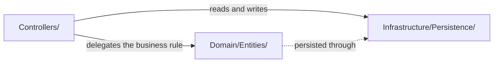

# 🎓 Concepts & How It Works Under the Hood

🇬🇧 **English** | [🇪🇸 Español](./Concepts.es.md)

> This document is different from the others: it's not a precise technical reference (that's [Architecture.md](../Architecture/Architecture.en.md)) — it's a plain-language explanation of **why** the backend is built the way it is, aimed at someone who isn't writing the code day to day but wants to actually understand it. It uses real examples from this project, not generic ones.

---

## 📋 Table of Contents

1. [What is all this, broadly?](#-what-is-all-this-broadly)
2. [The language and framework: C# and ASP.NET Core](#-the-language-and-framework-c-and-aspnet-core)
3. [A REST API, without the jargon](#-a-rest-api-without-the-jargon)
4. [The three layers: Controllers, Domain, Infrastructure](#-the-three-layers-controllers-domain-infrastructure)
5. [Entity Framework Core: what an ORM is](#-entity-framework-core-what-an-orm-is)
6. [Migrations: version control for the database](#-migrations-version-control-for-the-database)
7. [SQLite: why this database engine](#-sqlite-why-this-database-engine)
8. [Dependency injection: who builds what](#-dependency-injection-who-builds-what)
9. [The middleware pipeline](#-the-middleware-pipeline)
10. [Centralized error handling](#-centralized-error-handling)
11. [DTOs vs. entities: two shapes for the same data](#-dtos-vs-entities-two-shapes-for-the-same-data)
12. [Where each validation lives](#-where-each-validation-lives)
13. [`TimeProvider`: why not just call `DateTime.Now`](#-timeprovider-why-not-just-call-datetimenow)
14. [The tests: what they cover and how](#-the-tests-what-they-cover-and-how)
15. [Startup, database location, and backups](#-startup-database-location-and-backups)
16. [Quick glossary](#-quick-glossary)

---

## 🧭 What is all this, broadly?

The backend is a program that stays running on your computer, listening on a local address (something like `http://localhost:5166`), waiting for requests. When the future frontend (or, for now, you by hand with an `.http` file) asks it for something — "give me the list of subscriptions," "create a new category" — the backend:

1. Receives the request.
2. Figures out which code should run to answer it.
3. If needed, reads from or writes to the database file (`data.db`).
4. Returns a response.

All of this runs in a single process, on your machine, with no external server involved — this is what the [V1 Specification](../Specification/SpecificationV1.es.md) calls "local-first."

---

## 🛠 The language and framework: C# and ASP.NET Core

- **C#** is the programming language (Microsoft's, similar to Java if you know that). Every `.cs` file in the project is written in C#.
- **.NET** is the platform/runtime that executes C# code — like the JVM for Java, or Node.js for JavaScript.
- **ASP.NET Core** is the framework, within .NET, specifically for building web applications and APIs. It's the piece that knows how to listen for HTTP requests, route them to the right code, and send back responses.
- **ASP.NET Core Web API** (what's used here) is the "flavor" of ASP.NET Core meant for returning data (usually JSON) instead of HTML pages — because this is an API for the frontend to consume, not a website viewed directly in a browser.

Within ASP.NET Core there are two styles for defining what code answers what request: **Minimal API** (everything in a few lines inside `Program.cs`) and **Controllers** (one class per group of endpoints, with attributes like `[ApiController]`). This project uses **Controllers** — that's why `Controllers/CategoriesController.cs`, `Controllers/SubscriptionsController.cs`, etc. each exist, grouping the endpoints for one resource.

---

## 🌐 A REST API, without the jargon

A "REST API" is just an agreed-upon way of asking for things over HTTP:

- Each "thing" you can act on is a **resource** (a subscription, a category...), identified by a URL: `/api/Subscriptions`, `/api/Subscriptions/5`.
- The **HTTP verb** says what you want to do with that resource:
  - `GET` → read (nothing changes).
  - `POST` → create something new.
  - `PUT` → update something that already exists.
  - `DELETE` → delete it.
- The response's **status code** says how it went: `200` (OK), `201` (created), `204` (done, nothing to return), `400` (you asked for something invalid), `404` (doesn't exist), `409` (conflicts with something already there).
- The request/response **body** is usually **JSON** — structured text like `{ "name": "Netflix", "price": 14.99 }`.

The exact detail for every endpoint in this project lives in the [API Reference](../Api/Api.en.md); this is just the general idea.

---

## 🧱 The three layers: Controllers, Domain, Infrastructure

The code is deliberately split into three distinct responsibilities, so each change only touches what it needs to:



- **`Controllers/`** — the front door. Translates an HTTP request into a code call, and the result back into an HTTP response. It doesn't decide **business rules** (like "price can't be negative") — that lives one layer down.
- **`Domain/Entities/`** — the heart of the application. This is where the classes representing real concepts live (`Subscription`, `Category`, `PriceHistory`), along with **every** rule that must always hold, no matter who uses them. For example, `Subscription.ChangePrice()` is the only way to change a price, and internally it makes sure a history entry gets recorded — nobody can "skip" that rule by assigning the field directly, because the field has a `private set`.
- **`Infrastructure/Persistence/`** — everything related to saving and reading from the database: the `DbContext`, the table configurations, and (since today's sub-step) how the file path is resolved and how it migrates.

Why split it this way? If one day we switch from SQLite to another database engine, or add a second way of creating expenses (say, from the V1's bank-statement importer), the business rules in `Domain/` don't have to change a single line.

---

## 🗄 Entity Framework Core: what an ORM is

Writing raw SQL by hand for every query is tedious and easy to get wrong. An **ORM** ("Object-Relational Mapper") is a library that lets you work with **C# objects** and translates that into SQL for you.

**Entity Framework Core** (EF Core) is the ORM this project uses. The key pieces:

- **`SubscriptionManagerDbContext`** — the class representing "the whole database connection." It exposes one property per table (`Categories`, `Subscriptions`, `PriceHistories`), each of type `DbSet<T>`.
- **`DbSet<Category>`** — behaves almost like an in-memory list (`context.Categories.Where(...)`, `context.Categories.Add(...)`), but underneath, EF Core translates that into real SQL against SQLite.
- When a controller does `context.Categories.Add(newCategory)` and then `await context.SaveChangesAsync()`, EF Core generates an `INSERT INTO Categories (...) VALUES (...)` and runs it.
- **The "configurations"** (`Infrastructure/Persistence/Configurations/CategoryConfiguration.cs`, etc.) tell EF Core details a plain C# class can't express on its own: max length of a text field, which column is unique, what happens when you delete something with related rows (`RESTRICT` vs `CASCADE`). This is called **Fluent API**, used here instead of putting attributes directly on `Category`/`Subscription` so those domain classes stay completely unaware that a database even exists.

---

## 🧬 Migrations: version control for the database

This is probably the least intuitive piece, so let's take it slow.

**The problem they solve**: the C# classes (`Category`, `Subscription`...) change over time — you add a field, remove another. The SQLite database has to reflect that exact shape, with matching tables and columns. But **we never edit the SQLite file by hand**, and never write `CREATE TABLE` ourselves.

**The solution**: every time the domain model changes, we tell EF Core "generate whatever schema change is needed," with the command `dotnet ef migrations add SomeChangeName`. This creates a new file in `Migrations/` (e.g. `20261101113331_AddUniqueNameConstraints.cs`) with two methods: `Up()` (how to apply the change) and `Down()` (how to undo it). It's literally the same concept as a git commit, but for the database's structure instead of the code: each migration is one step, in order, and applying them all in order leaves you with the current schema.

**Who applies them, and when?** This is exactly what changed in today's sub-step:
- **Before**: you had to run `dotnet ef database update` by hand, every time there was a new migration. Fine for a developer with the .NET SDK installed, impossible for an end user who just wants to open the app.
- **Now**: `Program.cs` checks on its own, every time the app starts, whether any migration is still unapplied (`context.Database.GetPendingMigrations()`), and if so, applies it on its own (`context.Database.Migrate()`) — after backing up the `.db` file exactly as it was, in case something goes wrong. This is done by the new `DatabaseMigrationService` class.

**`SubscriptionManagerDbContextModelSnapshot.cs`** is a special file: a complete "snapshot" of what the schema should look like after applying every migration so far. EF Core uses it to automatically figure out what's changed the next time you generate a migration — it compares your current C# model against this snapshot, and the difference becomes the new migration.

---

## 🪶 SQLite: why this database engine

**SQLite** isn't a database server like PostgreSQL or MySQL (those run as a separate process, usually on another machine). SQLite is, literally, **a single file** on disk (`data.db`) that any program can read and write directly, with nothing to install or keep running in the background. That's exactly why it fits a "local-first" app: nothing to install, configure, or maintain — the file is the entire database.

One quirk that matters here: SQLite has no native `DECIMAL` numeric type that can store money without rounding errors. So EF Core stores `decimal` fields (like `Price`) as **text**, in a format that keeps the exact precision. That has a practical consequence: prices can't be summed with a direct SQL query (SQLite would treat them as text, not numbers) — which is why the expense summary (`ExpensesController`) loads the subscriptions and sums the prices **in memory**, in C#, rather than with a database aggregation query.

---

## 🔌 Dependency injection: who builds what

If you look at any controller, say `CategoriesController`, you'll never see a `new SubscriptionManagerDbContext(...)` inside it. Instead, the `DbContext` just "shows up" as a parameter of the controller. This is **dependency injection** (DI):

1. At startup, `Program.cs` tells ASP.NET Core's container "whenever someone needs a `SubscriptionManagerDbContext`, build it like this" (`builder.Services.AddDbContext<...>(...)`).
2. When a request comes in and a `CategoriesController` is needed, ASP.NET Core looks at what its constructor asks for, sees it wants a `SubscriptionManagerDbContext`, and hands it one — built following the recipe from step 1.
3. Same thing happens for `TimeProvider`, `ArgumentExceptionHandler`, etc.

Why not just `new` it wherever needed? Because this way, in tests, we can tell the container "for this `DbContext`, use one pointing at an in-memory database instead" (exactly what `WebApiFactory.cs` does) — the controller never even notices the swap, because it never decided for itself how its own `DbContext` gets created.

---

## 🚦 The middleware pipeline

Every HTTP request, before reaching the controller, passes through a chain of steps registered in `Program.cs`, in this exact order:

```
UseExceptionHandler()  →  MapOpenApi() [dev only]  →  UseHttpsRedirection()  →  MapControllers()
```

Each of these is a **middleware**: a piece that can look at the request, do something, and decide whether to pass it to the next one or stop right there. Order matters a lot — `UseExceptionHandler()` goes first because it needs to "wrap" everything that comes after; if a controller throws, it has to be able to catch it before it escapes uncontrolled.

See the full diagram in [Architecture.md](../Architecture/Architecture.en.md#-startup-sequence).

---

## 🧯 Centralized error handling

Instead of putting a `try/catch` in every single controller action, this project defines two classes implementing `IExceptionHandler`:

- **`ArgumentExceptionHandler`** — if something throws `ArgumentException` (e.g. `Subscription` rejecting a negative price), it turns that into a `400` response.
- **`DbUpdateExceptionHandler`** — if EF Core throws `DbUpdateException` **and** it's a genuine database constraint violation (a duplicate name, a delete blocked by a foreign key), it turns that into `409`. Any other kind of database failure (e.g. a transient lock) is left alone — and surfaces as a genuine `500`, instead of lying that it was a conflict when it wasn't.

These two classes are registered once in `Program.cs`, and the `UseExceptionHandler()` middleware tries them in order whenever something throws uncaught. That way, "what each kind of error means" is decided in exactly one place, not repeated across 16 different actions.

---

## 📦 DTOs vs. entities: two shapes for the same data

You've probably noticed there are two "versions" of everything: `Subscription` (in `Domain/Entities/`) and `SubscriptionResponse`/`SubscriptionCreateRequest` (in `DTO/`). A **DTO** (*Data Transfer Object*) is the shape that travels over HTTP — what the client sends or receives as JSON.

Why not just use `Subscription` directly as the response? Because this way, the API's public contract (what the frontend sees) can stay stable even if the domain model's internals change — and because some internal details (like the private parameterless constructor EF Core uses) have no business showing up in a JSON payload.

---

## ✅ Where each validation lives

Two different kinds of validation, in two different places, on purpose:

- **Shape validation**, in the DTOs — e.g. `[EnumDataType(typeof(BillingCycle))]` on a property rejects a number that doesn't match any enum value, **before** the request even reaches the controller.
- **Business rules**, in the `Domain/` entities — e.g. "price can't be negative" is `ArgumentOutOfRangeException.ThrowIfNegative(price)` inside `Subscription`'s constructor, not in the controller or the DTO. That way, no matter which path tries to create a subscription (today the controller, maybe tomorrow the V1's bank importer), the rule always holds, because it's attached to the object itself, not to whoever's using it.

---

## ⏰ `TimeProvider`: why not just call `DateTime.Now`

If the code called `DateTime.Now` directly to find out "what day is it today," it would be nearly impossible to write a test checking "what happens if today is January 31st?" — you'd have to literally wait until it was January 31st.

`TimeProvider` is a piece of .NET built exactly for this: instead of asking the system clock directly, code asks an injected `TimeProvider` (just like the `DbContext`) for "now." In production, that `TimeProvider` is `TimeProvider.System` (the real clock). In tests, it can be swapped for a fake one that says "today is whatever day I pick" — for example, `DatabaseMigrationServiceTests` uses one fixed to 2026-11-21 so the backup file's name is predictable and checkable.

---

## 🧪 The tests: what they cover and how

Two kinds of tests live together under `backend/tests/SubscriptionManager.API.Tests/`:

- **Unit tests** — test a single piece of logic, in isolation, with no server and no real database. For example, `SubscriptionRenewalDateTests` calls `Subscription.GetNextRenewalDate(...)` directly with specific dates and checks the result.
- **Integration tests** — boot the whole real application (controllers, middleware, error handling) against an **in-memory** SQLite database (lives only for the duration of the test, never touches disk), using `WebApplicationFactory<Program>`. This is what `WebApiFactory.cs` does: it swaps the real `DbContext` for one pointing at that temporary database, so the full HTTP flow can be tested without risking or depending on any real file.

See the [Testing Guide](../Testing/Testing.en.md) for the file-by-file detail.

---

## 🚀 Startup, database location, and backups

Summary of what today's sub-step settled (full detail in [Database.en.md](../Database/Database.en.md) and [Architecture.en.md](../Architecture/Architecture.en.md)):

1. Unless configured otherwise, the database lives in the user's own application data folder (not inside the project folder) — so everyone who installs the app gets their own file, in their operating system's standard spot.
2. On startup, if a pending migration is detected, the file is first copied, as-is, into a `backups/` folder, and only then is the change applied — and never more than 10 copies are kept.
3. All of this is skipped during tests (the `"Testing"` environment), so a real database is never accidentally touched.

And since this API has no login or password of any kind, two more checks keep it from being reachable from outside your own computer: the app **refuses to start** if it's configured to listen anywhere other than `localhost`/`127.0.0.1` (`StartupSecurity`), and any request whose `Host` header isn't one of those gets rejected with `400` before reaching any controller (`AllowedHosts` + `UseHostFiltering()`) — so a web page open in your browser can't "talk" to the API even if it tries to.

---

## 📖 Quick glossary

| Term | What it means here |
|---|---|
| **ORM** | A library that translates between C# objects and database rows (EF Core). |
| **`DbContext`** | The class representing the whole database connection/session. |
| **`DbSet<T>`** | One table, viewed as if it were a collection of C# objects. |
| **Migration** | A versioned schema change, generated and applied by EF Core. |
| **Dependency injection (DI)** | The container creates and hands out the objects each class needs, instead of each class building them itself. |
| **Middleware** | One step in the chain that processes every HTTP request before it reaches the controller. |
| **DTO** | The shape of the data that travels over HTTP, distinct from the domain entity. |
| **Domain entity** | The C# class representing a real concept and its rules (`Subscription`, `Category`...). |
| **Guard clause** | A check at the start of a method that throws if something isn't valid. |
| **`IExceptionHandler`** | A class that decides what HTTP status to return when something throws uncaught. |
| **Fluent API** | A way to configure how an entity is persisted, without touching the class itself. |

---

<p align="center"><sub>Last updated: 2026-11-21</sub></p>
