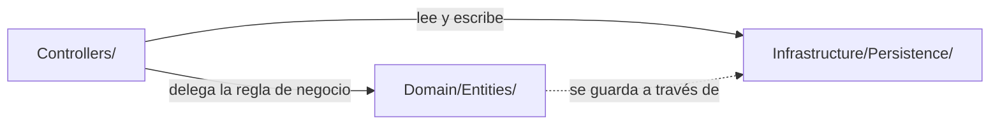

# 🎓 Conceptos y Funcionamiento Interno

[🇬🇧 English](./Concepts.en.md) | 🇪🇸 **Español**

> Este documento es distinto a los demás: no es una referencia técnica exacta (eso es [Architecture.md](../Architecture/Architecture.es.md)), es una explicación en lenguaje llano de **por qué** el backend está construido así, pensada para quien no escribe el código a diario pero quiere entenderlo de verdad. Usa ejemplos reales de este mismo proyecto, no genéricos.

---

## 📋 Índice

1. [¿Qué es, a grandes rasgos, todo esto?](#-qué-es-a-grandes-rasgos-todo-esto)
2. [El lenguaje y el framework: C# y ASP.NET Core](#-el-lenguaje-y-el-framework-c-y-aspnet-core)
3. [Una API REST, explicada sin tecnicismos](#-una-api-rest-explicada-sin-tecnicismos)
4. [Las tres capas: Controllers, Domain, Infrastructure](#-las-tres-capas-controllers-domain-infrastructure)
5. [Entity Framework Core: qué es un ORM](#-entity-framework-core-qué-es-un-orm)
6. [Las migraciones: el control de versiones de la base de datos](#-las-migraciones-el-control-de-versiones-de-la-base-de-datos)
7. [SQLite: por qué este motor de base de datos](#-sqlite-por-qué-este-motor-de-base-de-datos)
8. [Inyección de dependencias: quién construye qué](#-inyección-de-dependencias-quién-construye-qué)
9. [El pipeline de middleware](#-el-pipeline-de-middleware)
10. [Manejo de errores centralizado](#-manejo-de-errores-centralizado)
11. [DTOs contra entidades: dos formas de los mismos datos](#-dtos-contra-entidades-dos-formas-de-los-mismos-datos)
12. [Dónde vive cada validación](#-dónde-vive-cada-validación)
13. [`TimeProvider`: por qué no usar `DateTime.Now` directamente](#-timeprovider-por-qué-no-usar-datetimenow-directamente)
14. [Los tests: qué prueban y cómo](#-los-tests-qué-prueban-y-cómo)
15. [Arranque, ubicación de la base de datos y copias de seguridad](#-arranque-ubicación-de-la-base-de-datos-y-copias-de-seguridad)
16. [Glosario rápido](#-glosario-rápido)

---

## 🧭 ¿Qué es, a grandes rasgos, todo esto?

El backend es un programa que se queda corriendo en tu ordenador, escuchando en una dirección local (algo como `http://localhost:5166`), esperando peticiones. Cuando el futuro frontend (o, de momento, tú a mano con un fichero `.http`) le pide algo — "dame la lista de suscripciones", "crea una categoría nueva" — el backend:

1. Recibe la petición.
2. Decide qué código tiene que ejecutarse para responderla.
3. Si hace falta, lee o escribe en el fichero de base de datos (`data.db`).
4. Devuelve una respuesta.

Todo esto corre en un único proceso, en tu máquina, sin ningún servidor externo — es lo que en la [Especificación de la V1](../Specification/SpecificationV1.es.md) se llama "local primero".

---

## 🛠 El lenguaje y el framework: C# y ASP.NET Core

- **C#** es el lenguaje de programación (de Microsoft, parecido a Java si lo conoces). Todos los ficheros `.cs` del proyecto están escritos en C#.
- **.NET** es la plataforma/runtime que ejecuta el código C# — como la JVM para Java, o Node.js para JavaScript.
- **ASP.NET Core** es el framework, dentro de .NET, específico para construir aplicaciones web y APIs. Es el que sabe escuchar peticiones HTTP, enrutarlas al código correcto, y devolver respuestas.
- **ASP.NET Core Web API** (lo que usamos aquí) es el "sabor" de ASP.NET Core pensado para devolver datos (normalmente JSON) en vez de páginas HTML — porque esto es una API para que la consuma el frontend, no una web que se vea directamente en el navegador.

Dentro de ASP.NET Core hay dos estilos para definir qué código responde a qué petición: **Minimal API** (todo en unas pocas líneas en `Program.cs`) y **Controllers** (una clase por grupo de endpoints, con atributos como `[ApiController]`). Este proyecto usa **Controllers** — por eso existe `Controllers/CategoriesController.cs`, `Controllers/SubscriptionsController.cs`, etc., cada uno agrupando los endpoints de un recurso.

---

## 🌐 Una API REST, explicada sin tecnicismos

Una "API REST" es simplemente un acuerdo de cómo pedir cosas por HTTP:

- Cada "cosa" sobre la que puedes operar es un **recurso** (una suscripción, una categoría...), identificado por una URL: `/api/Subscriptions`, `/api/Subscriptions/5`.
- El **verbo HTTP** dice qué quieres hacer con ese recurso:
  - `GET` → leer (sin cambiar nada).
  - `POST` → crear algo nuevo.
  - `PUT` → actualizar algo que ya existe.
  - `DELETE` → borrarlo.
- El **código de estado** de la respuesta dice cómo fue: `200` (OK), `201` (creado), `204` (hecho, sin contenido que devolver), `400` (pediste algo inválido), `404` (no existe), `409` (choca con algo que ya había).
- El **cuerpo** de la petición/respuesta normalmente es **JSON** — texto estructurado como `{ "name": "Netflix", "price": 14.99 }`.

Todo el detalle exacto de cada endpoint de este proyecto está en la [Referencia de la API](../Api/Api.es.md); esto es solo la idea general.

---

## 🧱 Las tres capas: Controllers, Domain, Infrastructure

El código está deliberadamente repartido en tres responsabilidades distintas, para que cada cambio toque solo lo que tiene que tocar:



- **`Controllers/`** — la puerta de entrada. Traduce una petición HTTP a una llamada de código, y el resultado de vuelta a una respuesta HTTP. No decide **reglas de negocio** (como "el precio no puede ser negativo") — eso vive un nivel más abajo.
- **`Domain/Entities/`** — el corazón de la aplicación. Aquí viven las clases que representan los conceptos reales (`Subscription`, `Category`, `PriceHistory`) y **todas** las reglas que deben cumplir siempre, sin importar quién las use. Por ejemplo, `Subscription.ChangePrice()` es la única forma de cambiar un precio, y por dentro se asegura de que quede registrado en el historial — nadie puede "saltarse" esa regla asignando el campo directamente, porque el campo tiene un `private set`.
- **`Infrastructure/Persistence/`** — todo lo relacionado con guardar y leer de la base de datos: el `DbContext`, las configuraciones de tabla, y (desde el sub-paso de hoy) cómo se resuelve la ruta del fichero y cómo se migra.

¿Por qué separarlo así? Si un día cambiamos de SQLite a otro motor de base de datos, o si añadimos una segunda forma de crear suscripciones (por ejemplo, desde el importador bancario de la V1), las reglas de negocio en `Domain/` no tienen que cambiar ni una línea.

---

## 🗄 Entity Framework Core: qué es un ORM

Escribir SQL a mano por cada consulta es tedioso y fácil de hacer mal. Un **ORM** ("Object-Relational Mapper") es una librería que te deja trabajar con **objetos de C#** y traduce eso a SQL por ti.

**Entity Framework Core** (EF Core) es el ORM que usa este proyecto. Las piezas clave:

- **`SubscriptionManagerDbContext`** — la clase que representa "la conexión a la base de datos entera". Expone una propiedad por cada tabla (`Categories`, `Subscriptions`, `PriceHistories`), cada una de tipo `DbSet<T>`.
- **`DbSet<Category>`** — se comporta casi como una lista en memoria (`context.Categories.Where(...)`, `context.Categories.Add(...)`), pero por debajo, EF Core traduce eso a SQL real contra SQLite.
- Cuando un controller hace `context.Categories.Add(nuevaCategoria)` y luego `await context.SaveChangesAsync()`, EF Core genera un `INSERT INTO Categories (...) VALUES (...)` y lo ejecuta.
- **Las "configuraciones"** (`Infrastructure/Persistence/Configurations/CategoryConfiguration.cs`, etc.) le dicen a EF Core detalles que una clase C# no puede expresar por sí sola: longitud máxima de un texto, qué columna es única, qué pasa si borras algo que tiene cosas relacionadas (`RESTRICT` vs `CASCADE`). Esto se llama **Fluent API**, y se usa aquí en vez de poner atributos directamente sobre `Category`/`Subscription` para que esas clases de dominio no sepan nada de bases de datos — ni siquiera que existen.

---

## 🧬 Las migraciones: el control de versiones de la base de datos

Esta es la pieza que probablemente menos intuitiva te resulte, así que con calma.

**El problema que resuelven**: las clases C# (`Category`, `Subscription`...) cambian con el tiempo — añades un campo, quitas otro. La base de datos SQLite tiene que reflejar exactamente esa forma, con sus tablas y columnas. Pero **nunca editamos el fichero SQLite a mano**, ni escribimos `CREATE TABLE` nosotros mismos.

**La solución**: cada vez que cambiamos el modelo de dominio, le decimos a EF Core "genera el cambio de esquema que haga falta", con el comando `dotnet ef migrations add NombreDelCambio`. Esto crea un fichero nuevo en `Migrations/` (p. ej. `20261101113331_AddUniqueNameConstraints.cs`) con dos métodos: `Up()` (qué hacer para aplicar el cambio) y `Down()` (cómo deshacerlo). Es literalmente el mismo concepto que un commit de git, pero para la estructura de la base de datos en vez de para el código: cada migración es un paso, en orden, y aplicarlas todas en orden te deja con el esquema actual.

**¿Quién las aplica, y cuándo?** Aquí es donde ha cambiado algo justo en el sub-paso de hoy:
- **Antes**: había que ejecutar `dotnet ef database update` a mano, cada vez que había una migración nueva. Cómodo para un desarrollador con el SDK de .NET instalado, inviable para un usuario final que solo quiere abrir la app.
- **Ahora**: `Program.cs` comprueba él solo, cada vez que arranca la app, si hay alguna migración sin aplicar (`context.Database.GetPendingMigrations()`), y si la hay, la aplica sola (`context.Database.Migrate()`) — después de hacer una copia de seguridad del fichero `.db` tal y como estaba, por si algo saliera mal. Esto lo hace la clase nueva `DatabaseMigrationService`.

**`SubscriptionManagerDbContextModelSnapshot.cs`** es un fichero especial: una "foto" completa de cómo debería quedar el esquema después de aplicar todas las migraciones hasta ahora. EF Core la usa para calcular automáticamente qué cambios hacen falta la próxima vez que generes una migración — compara tu modelo C# actual contra esta foto, y la diferencia es la migración nueva.

---

## 🪶 SQLite: por qué este motor de base de datos

**SQLite** no es un servidor de base de datos como PostgreSQL o MySQL (esos corren como un proceso aparte, normalmente en otra máquina). SQLite es, literalmente, **un único fichero** en disco (`data.db`) que cualquier programa puede leer y escribir directamente, sin necesitar ni instalar ni arrancar nada más. Por eso es perfecto para una app "local primero": no hay nada que instalar, configurar, ni mantener corriendo de fondo — el fichero es la base de datos entera.

Una peculiaridad importante para este proyecto: SQLite no tiene un tipo numérico `DECIMAL` nativo capaz de guardar dinero sin errores de redondeo. Por eso, EF Core guarda los campos `decimal` (como `Price`) como **texto**, en un formato que conserva la precisión exacta. Esto tiene una consecuencia práctica: no se pueden sumar precios con una consulta SQL directamente (SQLite los trataría como texto, no como números) — por eso el resumen de gastos (`ExpensesController`) carga las suscripciones y suma los precios **en memoria**, en C#, no con una consulta de agregación en la base de datos.

---

## 🔌 Inyección de dependencias: quién construye qué

Si miras cualquier controller, por ejemplo `CategoriesController`, nunca ves un `new SubscriptionManagerDbContext(...)` dentro de él. En vez de eso, el `DbContext` simplemente "aparece" como parámetro del controller. Esto es **inyección de dependencias** (DI, *Dependency Injection*):

1. Al arrancar, `Program.cs` le dice al contenedor de ASP.NET Core "cuando alguien necesite un `SubscriptionManagerDbContext`, créalo así" (`builder.Services.AddDbContext<...>(...)`).
2. Cuando llega una petición y hace falta un `CategoriesController`, ASP.NET Core mira qué necesita su constructor, ve que pide un `SubscriptionManagerDbContext`, y se lo da — creado siguiendo la receta del paso 1.
3. Lo mismo pasa con `TimeProvider`, `ArgumentExceptionHandler`, etc.

¿Por qué no simplemente hacer `new` donde haga falta? Porque así, en los tests, podemos decirle al contenedor "para este `DbContext`, usa en su lugar uno que apunte a una base de datos en memoria" (exactamente lo que hace `WebApiFactory.cs`) — el controller ni se entera del cambio, porque nunca decidió él mismo cómo se crea su propio `DbContext`.

---

## 🚦 El pipeline de middleware

Cada petición HTTP, antes de llegar al controller, pasa por una cadena de pasos registrados en `Program.cs`, en este orden exacto:

```
UseExceptionHandler()  →  MapOpenApi() [solo en desarrollo]  →  UseHttpsRedirection()  →  MapControllers()
```

Cada uno de estos es un **middleware**: una pieza que puede mirar la petición, hacer algo, y decidir si se la pasa al siguiente o corta ahí mismo. El orden importa muchísimo — `UseExceptionHandler()` va el primero porque tiene que "envolver" a todos los que vienen después; si un controller lanza una excepción, tiene que poder atraparla antes de que se escape sin control.

Ver el diagrama completo en [Architecture.md](../Architecture/Architecture.es.md#-secuencia-de-arranque).

---

## 🧯 Manejo de errores centralizado

En vez de poner un `try/catch` en cada acción de cada controller, este proyecto define dos clases que implementan `IExceptionHandler`:

- **`ArgumentExceptionHandler`** — si algo lanza `ArgumentException` (p. ej. `Subscription` rechazando un precio negativo), lo convierte en una respuesta `400`.
- **`DbUpdateExceptionHandler`** — si EF Core lanza `DbUpdateException` **y** es una violación real de una restricción de la base de datos (un nombre duplicado, un borrado bloqueado por una clave foránea), lo convierte en `409`. Si es cualquier otro tipo de fallo de base de datos (p. ej. un bloqueo temporal), lo deja pasar — y acaba como un `500` genuino, en vez de mentir diciendo que fue un conflicto cuando no lo fue.

Estas dos clases se registran una vez en `Program.cs`, y el middleware `UseExceptionHandler()` las prueba en orden cada vez que algo lanza una excepción sin capturar. Así, "qué significa cada tipo de error" se decide en un solo sitio, no repetido en 16 acciones distintas.

---

## 📦 DTOs contra entidades: dos formas de los mismos datos

Te habrás fijado en que hay dos "versiones" de cada cosa: `Subscription` (en `Domain/Entities/`) y `SubscriptionResponse`/`SubscriptionCreateRequest` (en `DTO/`). Un **DTO** (*Data Transfer Object*) es la forma que viaja por HTTP — lo que el cliente manda o recibe como JSON.

¿Por qué no usar `Subscription` directamente como respuesta? Porque así el contrato público de la API (lo que ve el frontend) puede quedarse estable aunque por dentro cambiemos cómo está modelado el dominio — y porque hay datos internos (como el constructor privado sin parámetros que usa EF Core) que no tiene sentido que aparezcan en un JSON.

---

## ✅ Dónde vive cada validación

Dos tipos distintos de validación, en dos sitios distintos, a propósito:

- **Validación de formato**, en los DTOs — por ejemplo, `[EnumDataType(typeof(BillingCycle))]` sobre una propiedad rechaza un número que no corresponde a ningún valor del enum, **antes** de que la petición llegue siquiera al controller.
- **Reglas de negocio**, en las entidades de `Domain/` — por ejemplo, "el precio no puede ser negativo" es `ArgumentOutOfRangeException.ThrowIfNegative(price)` dentro del constructor de `Subscription`, no en el controller ni en el DTO. Así, sea cual sea el camino por el que se intente crear una suscripción (hoy el controller, en el futuro quizá el importador bancario de la V1), la regla se cumple siempre, porque está pegada al propio objeto, no a quien lo usa.

---

## ⏰ `TimeProvider`: por qué no usar `DateTime.Now` directamente

Si el código llamara directamente a `DateTime.Now` para saber "qué día es hoy", sería casi imposible escribir un test que compruebe "¿qué pasa si hoy es 31 de enero?" — tendrías que esperar literalmente a que fuera 31 de enero.

`TimeProvider` es una pieza de .NET pensada exactamente para esto: en vez de preguntar directamente al reloj del sistema, el código pide "la hora de ahora" a un `TimeProvider` inyectado (igual que el `DbContext`). En producción, ese `TimeProvider` es `TimeProvider.System` (el reloj real). En los tests, se puede sustituir por uno falso que diga "hoy es el día que yo quiera" — por ejemplo, `DatabaseMigrationServiceTests` usa uno fijado al 2026-11-21 para que el nombre del fichero de copia de seguridad sea predecible y comprobable.

---

## 🧪 Los tests: qué prueban y cómo

Dos tipos de test convive en `backend/tests/SubscriptionManager.API.Tests/`:

- **Tests unitarios** — prueban una sola pieza de lógica, aislada, sin servidor ni base de datos real. Por ejemplo, `SubscriptionRenewalDateTests` llama directamente a `Subscription.GetNextRenewalDate(...)` con fechas concretas y comprueba el resultado.
- **Tests de integración** — arrancan la aplicación real entera (controllers, middleware, manejo de errores) contra una base de datos SQLite **en memoria** (vive solo mientras dura el test, nunca toca el disco), usando `WebApplicationFactory<Program>`. Esto es lo que hace `WebApiFactory.cs`: sustituye el `DbContext` real por uno que apunta a esa base de datos temporal, para poder probar el flujo HTTP completo sin arriesgar ni depender de ningún fichero de verdad.

Ver la [Guía de Pruebas](../Testing/Testing.es.md) para el detalle fichero a fichero.

---

## 🚀 Arranque, ubicación de la base de datos y copias de seguridad

Resumen de lo que se decidió en el sub-paso de hoy (detalle completo en [Database.es.md](../Database/Database.es.md) y [Architecture.es.md](../Architecture/Architecture.es.md)):

1. Si no se configura nada distinto, la base de datos vive en la carpeta de datos de la aplicación del propio usuario (no dentro de la carpeta del proyecto) — así cada persona que instale la app tiene su propio fichero, en el sitio estándar de su sistema operativo.
2. Al arrancar, si detecta una migración pendiente, primero copia el fichero tal cual estaba a una carpeta `backups/`, y solo después aplica el cambio — y nunca guarda más de 10 copias.
3. Todo esto se salta durante los tests (entorno `"Testing"`), para no arriesgar tocar jamás una base de datos de verdad por accidente.

Y, como esta API no tiene ningún tipo de login ni contraseña, dos comprobaciones más la protegen de ser alcanzable desde fuera de tu propio ordenador: la app se **niega a arrancar** si está configurada para escuchar en otro sitio que no sea `localhost`/`127.0.0.1` (`StartupSecurity`), y cualquier petición cuya cabecera `Host` no sea una de esas se rechaza con `400` antes de llegar a ningún controller (`AllowedHosts` + `UseHostFiltering()`) — así una página web abierta en tu navegador no puede "hablarle" a la API aunque lo intente.

---

## 📖 Glosario rápido

| Término | Qué significa aquí |
|---|---|
| **ORM** | Librería que traduce entre objetos C# y filas de base de datos (EF Core). |
| **`DbContext`** | La clase que representa toda la conexión/sesión con la base de datos. |
| **`DbSet<T>`** | Una tabla, vista como si fuera una colección de objetos C#. |
| **Migración** | Un cambio de esquema versionado, generado y aplicado por EF Core. |
| **Inyección de dependencias (DI)** | El contenedor crea y entrega los objetos que necesita cada clase, en vez de que cada clase se los construya ella misma. |
| **Middleware** | Un paso en la cadena que procesa cada petición HTTP antes de llegar al controller. |
| **DTO** | La forma de los datos que viaja por HTTP, distinta de la entidad de dominio. |
| **Entidad de dominio** | La clase C# que representa un concepto real y sus reglas (`Subscription`, `Category`...). |
| **Guard clause** | Una comprobación al principio de un método que lanza una excepción si algo no es válido. |
| **`IExceptionHandler`** | Una clase que decide qué código HTTP devolver cuando algo lanza una excepción sin capturar. |
| **Fluent API** | Forma de configurar cómo se guarda una entidad en la base de datos, sin tocar la clase misma. |

---

<p align="center"><sub>Última actualización: 2026-11-21</sub></p>
