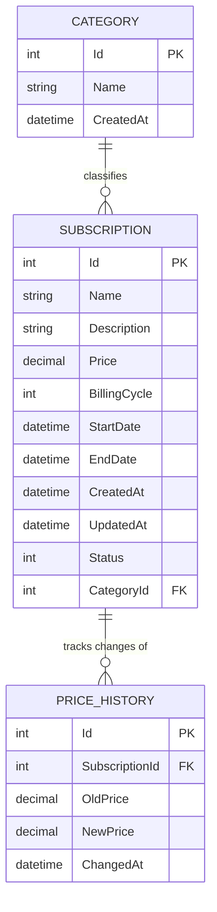

# 🗄️ Database Structure

🇬🇧 **English** | [🇪🇸 Español](./Database.es.md)

> Schema of the local SQLite database, generated from the EF Core domain model (see [Project Scope](../ProjectScope/ProjectScope.en.md)).

---

## 📋 Table of Contents

1. [Overview](#-overview)
2. [Entity-Relationship Diagram](#-entity-relationship-diagram)
3. [Tables](#-tables)
4. [Relationships](#-relationships)
5. [Enums Reference](#-enums-reference)

---

## 🔎 Overview

The database is a single local **SQLite** file (`subscriptionmanager.db`), managed entirely through **EF Core migrations** — the schema is never edited by hand, it's generated from the C# entities in `Domain/Entities/` plus the Fluent API configurations in `Infrastructure/Persistence/Configurations/`.

Three tables currently exist: `Categories`, `Subscriptions` and `PriceHistories`.

---

## 🧩 Entity-Relationship Diagram

---

## 📑 Tables

### `Categories`

| Column | Type | Constraints | Description |
|---|---|---|---|
| `Id` | `INTEGER` | PK, autoincrement | Unique identifier. |
| `Name` | `TEXT` | Required, max 100 chars | Category name (e.g. Streaming, Software). |
| `CreatedAt` | `TEXT` (DateTime) | Required | When the category was created (UTC). |

### `Subscriptions`

| Column | Type | Constraints | Description |
|---|---|---|---|
| `Id` | `INTEGER` | PK, autoincrement | Unique identifier. |
| `Name` | `TEXT` | Required, max 200 chars | Service name (e.g. Netflix). |
| `Description` | `TEXT` | Required, max 1000 chars | Free-text notes about the subscription. |
| `Price` | `TEXT` (decimal, precision 10,2) | Required | Current price. |
| `BillingCycle` | `INTEGER` (enum) | Required | How often it's billed. See [enum reference](#-enums-reference). |
| `StartDate` | `TEXT` (DateTime) | Required | When the subscription started. |
| `EndDate` | `TEXT` (DateTime) | Optional | When the subscription ended, if cancelled. |
| `CreatedAt` | `TEXT` (DateTime) | Required | Row creation timestamp (UTC). |
| `UpdatedAt` | `TEXT` (DateTime) | Required | Last update timestamp (UTC). |
| `Status` | `INTEGER` (enum) | Required | Current status. See [enum reference](#-enums-reference). |
| `CategoryId` | `INTEGER` | FK → `Categories.Id`, required | The category this subscription belongs to. |

### `PriceHistories`

| Column | Type | Constraints | Description |
|---|---|---|---|
| `Id` | `INTEGER` | PK, autoincrement | Unique identifier. |
| `SubscriptionId` | `INTEGER` | FK → `Subscriptions.Id`, required | The subscription this price change belongs to. |
| `OldPrice` | `TEXT` (decimal, precision 10,2) | Required | Price before the change. |
| `NewPrice` | `TEXT` (decimal, precision 10,2) | Required | Price after the change. |
| `ChangedAt` | `TEXT` (DateTime) | Required | When the price change happened (UTC) — also the row's creation time. |

> SQLite has no native `DECIMAL` type: EF Core's Sqlite provider stores `decimal` values as `TEXT` to preserve exact precision (no floating-point rounding).

---

## 🔗 Relationships

| Relationship | Cardinality | On Delete | Why |
|---|---|---|---|
| `Category` → `Subscription` | 1 category → many subscriptions | `RESTRICT` | Prevents deleting a category that still has subscriptions assigned to it — forces reassigning them first. |
| `Subscription` → `PriceHistory` | 1 subscription → many price history records | `CASCADE` | A price history record has no meaning without its subscription, so it's deleted along with it. |

---

## 🔢 Enums Reference

Enums are stored as plain integers in the database (EF Core's default). Reference when reading raw rows:

**`BillingCycle`** (on `Subscriptions.BillingCycle`)

| Value | Name |
|---|---|
| `0` | `Day` |
| `1` | `Monthly` |
| `2` | `Yearly` |

**`SubscriptionStatus`** (on `Subscriptions.Status`)

| Value | Name |
|---|---|
| `0` | `Active` |
| `1` | `Paused` |
| `2` | `Cancelled` |

---

Last updated: 2026-11-01

