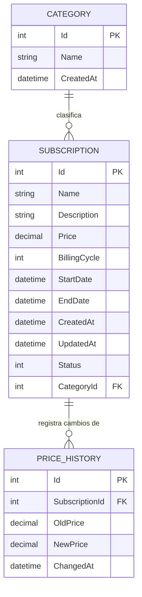

# 🗄️ Estructura de la Base de Datos

[🇬🇧 English](./Database.en.md) | 🇪🇸 **Español**

> Esquema de la base de datos local SQLite, generado a partir del modelo de dominio de EF Core (ver [Alcance del Proyecto](../ProjectScope/ProjectScope.es.md)).

---

## 📋 Índice

1. [Visión general](#-visión-general)
2. [Diagrama entidad-relación](#-diagrama-entidad-relación)
3. [Tablas](#-tablas)
4. [Relaciones](#-relaciones)
5. [Referencia de enums](#-referencia-de-enums)

---

## 🔎 Visión general

La base de datos es un único fichero local **SQLite** (`subscriptionmanager.db`), gestionado íntegramente mediante **migraciones de EF Core** — el esquema nunca se edita a mano, se genera a partir de las entidades C# de `Domain/Entities/` y las configuraciones Fluent API de `Infrastructure/Persistence/Configurations/`.

Actualmente existen tres tablas: `Categories`, `Subscriptions` y `PriceHistories`.

---

## 🧩 Diagrama entidad-relación

---

## 📑 Tablas

### `Categories`

| Columna | Tipo | Restricciones | Descripción |
|---|---|---|---|
| `Id` | `INTEGER` | PK, autoincremental | Identificador único. |
| `Name` | `TEXT` | Obligatorio, máx. 100 caracteres | Nombre de la categoría (p. ej. Streaming, Software). |
| `CreatedAt` | `TEXT` (DateTime) | Obligatorio | Fecha de creación de la categoría (UTC). |

### `Subscriptions`

| Columna | Tipo | Restricciones | Descripción |
|---|---|---|---|
| `Id` | `INTEGER` | PK, autoincremental | Identificador único. |
| `Name` | `TEXT` | Obligatorio, máx. 200 caracteres | Nombre del servicio (p. ej. Netflix). |
| `Description` | `TEXT` | Obligatorio, máx. 1000 caracteres | Notas libres sobre la suscripción. |
| `Price` | `TEXT` (decimal, precisión 10,2) | Obligatorio | Precio actual. |
| `BillingCycle` | `INTEGER` (enum) | Obligatorio | Frecuencia de cobro. Ver [referencia de enums](#-referencia-de-enums). |
| `StartDate` | `TEXT` (DateTime) | Obligatorio | Fecha de inicio de la suscripción. |
| `EndDate` | `TEXT` (DateTime) | Opcional | Fecha de fin, si se canceló. |
| `CreatedAt` | `TEXT` (DateTime) | Obligatorio | Fecha de creación del registro (UTC). |
| `UpdatedAt` | `TEXT` (DateTime) | Obligatorio | Fecha de última actualización (UTC). |
| `Status` | `INTEGER` (enum) | Obligatorio | Estado actual. Ver [referencia de enums](#-referencia-de-enums). |
| `CategoryId` | `INTEGER` | FK → `Categories.Id`, obligatorio | Categoría a la que pertenece la suscripción. |

### `PriceHistories`

| Columna | Tipo | Restricciones | Descripción |
|---|---|---|---|
| `Id` | `INTEGER` | PK, autoincremental | Identificador único. |
| `SubscriptionId` | `INTEGER` | FK → `Subscriptions.Id`, obligatorio | Suscripción a la que pertenece este cambio de precio. |
| `OldPrice` | `TEXT` (decimal, precisión 10,2) | Obligatorio | Precio antes del cambio. |
| `NewPrice` | `TEXT` (decimal, precisión 10,2) | Obligatorio | Precio después del cambio. |
| `ChangedAt` | `TEXT` (DateTime) | Obligatorio | Fecha del cambio de precio (UTC) — también la fecha de creación del registro. |

> SQLite no tiene un tipo `DECIMAL` nativo: el proveedor Sqlite de EF Core guarda los valores `decimal` como `TEXT` para preservar la precisión exacta (sin redondeos de coma flotante).

---

## 🔗 Relaciones

| Relación | Cardinalidad | Al borrar (`On Delete`) | Por qué |
|---|---|---|---|
| `Category` → `Subscription` | 1 categoría → muchas suscripciones | `RESTRICT` | Impide borrar una categoría que todavía tiene suscripciones asignadas — obliga a reasignarlas antes. |
| `Subscription` → `PriceHistory` | 1 suscripción → muchos registros de historial | `CASCADE` | Un registro de historial de precios no tiene sentido sin su suscripción, así que se borra junto con ella. |

---

## 🔢 Referencia de enums

Los enums se guardan como números enteros en la base de datos (comportamiento por defecto de EF Core). Útil al mirar filas en bruto:

**`BillingCycle`** (en `Subscriptions.BillingCycle`)

| Valor | Nombre |
|---|---|
| `0` | `Day` |
| `1` | `Monthly` |
| `2` | `Yearly` |

**`SubscriptionStatus`** (en `Subscriptions.Status`)

| Valor | Nombre |
|---|---|
| `0` | `Active` |
| `1` | `Paused` |
| `2` | `Cancelled` |

---

Última actualización: 2026-11-01

