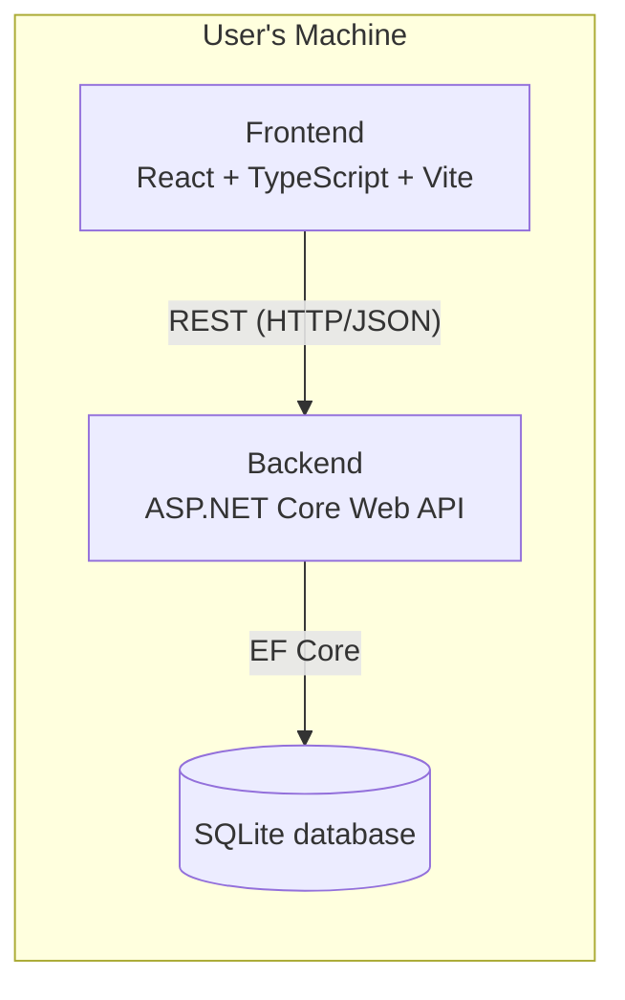

# 📦 Subscription Manager — Project Scope

🇬🇧 **English** | [🇪🇸 Español](./ProjectScope.es.md)

> Local-first subscription management application to track recurring payments, manage subscriptions, monitor price changes and visualize monthly and yearly expenses. Built with a REST API and a modern web interface, running entirely on your local machine with no cloud infrastructure required.

---

## 📋 Table of Contents

1. [Overview](#-overview)
2. [Objectives](#-objectives)
3. [Scope — MVP v1.0](#-scope--mvp-v10)
4. [Tech Stack](#-tech-stack)
5. [Architecture](#-architecture)
6. [Project Structure](#-project-structure)
7. [Out of Scope (MVP)](#-out-of-scope-mvp)

---

## 🔎 Overview

**Subscription Manager** is a local-first web application that helps users keep track of their recurring subscriptions (streaming services, software, memberships, etc.).

It provides a centralized overview of:

- Which services the user is subscribed to.
- How much each one costs and how often it's billed.
- When the next payment or renewal is due.
- How spending evolves over time (monthly / yearly).

**Local-first** means the entire application — API and data — runs on the user's own machine. There is no external cloud backend, no third-party server, and no account creation required to use the core functionality. The user's financial data never leaves their computer.

---

## 🎯 Objectives

- [ ] Centralize all subscriptions in a single application.
- [ ] Track recurring subscription expenses.
- [ ] Monitor upcoming payments and renewal dates.
- [ ] Detect and track price changes over time.
- [ ] Organize subscriptions into categories.
- [ ] Keep track of subscription status (active, paused, cancelled).
- [ ] Provide a clear overview of monthly and yearly expenses.
- [ ] Improve backend development skills using .NET and ASP.NET Core.

---

## 📐 Scope — MVP v1.0

The first version focuses on the core domain needed to manage subscriptions. The following entities define the MVP; their detailed attributes and relationships are still to be defined in the domain model.

| Entity | Purpose |
|---|---|
| **Subscription** | A recurring payment the user wants to track (service name, cost, billing cycle, renewal date, status). |
| **Category** | Groups subscriptions by type (e.g. Streaming, Software, Fitness) to organize and filter expenses. |
| **PriceHistory** | Records each price change of a subscription (old price, new price, date) so changes over time can be tracked. |

> The application is single-tenant and local-only, so a `User` entity is not needed for the MVP — there's no login and no multi-user data to distinguish. It may be introduced later if cloud sync or multi-user support is added (see [Out of Scope](#-out-of-scope-mvp)).

> ⚠️ **Note:** this table lists the core entities agreed on for the MVP. Attributes, relationships, and validation rules will be defined when the domain model is implemented.

---

## 🛠 Tech Stack

| Layer | Technology |
|---|---|
| Backend / API | ASP.NET Core Web API (.NET 10), C# |
| Persistence | Entity Framework Core + SQLite |
| Frontend | React, TypeScript, Vite, Tailwind CSS |
| Testing | xUnit |

---

## 🏗 Architecture

Everything runs locally: the web interface talks to the REST API, and the API persists data to a local SQLite database. No cloud services are involved.



---

## 📁 Project Structure

```
SubscriptionManager/
├── backend/
│   ├── src/
│   │   └── SubscriptionManager.API/   # ASP.NET Core Web API
│   └── tests/                         # xUnit test project(s)
├── frontend/                          # React + TypeScript + Vite app
└── docs/                              # Project documentation
```

---

## 🚫 Out of Scope (MVP)

The following are **not** part of v1.0. They may be considered for future iterations:

- Multi-user support / authentication across devices.
- Push notifications or email reminders.
- Direct bank or payment provider integrations.
- Mobile application.
- Cloud sync / backup.

---

<p align="center"><sub>Last updated: 2026-10-31</sub></p>
