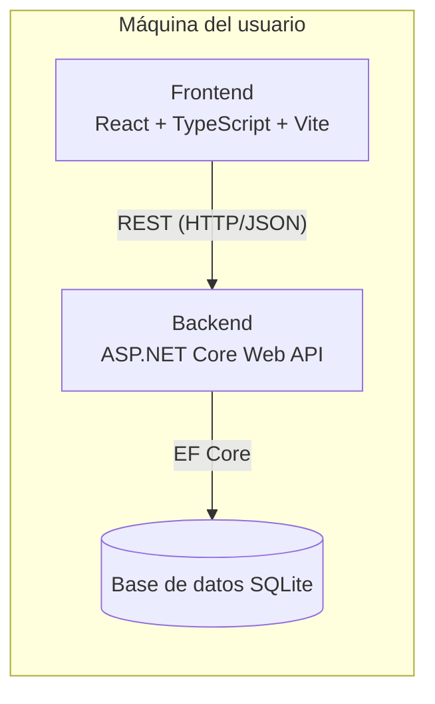

# 📦 Subscription Manager — Alcance del Proyecto

[🇬🇧 English](./ProjectScope.en.md) | 🇪🇸 **Español**

> Aplicación local de gestión de suscripciones para controlar pagos recurrentes, gestionar suscripciones, monitorizar cambios de precio y visualizar gastos mensuales y anuales. Construida con una API REST y una interfaz web moderna, funcionando íntegramente en tu máquina local sin necesidad de infraestructura en la nube.

---

## 📋 Índice

1. [Visión general](#-visión-general)
2. [Objetivos](#-objetivos)
3. [Alcance — MVP v1.0](#-alcance--mvp-v10)
4. [Stack tecnológico](#-stack-tecnológico)
5. [Arquitectura](#-arquitectura)
6. [Estructura del proyecto](#-estructura-del-proyecto)
7. [Fuera de alcance (MVP)](#-fuera-de-alcance-mvp)

---

## 🔎 Visión general

**Subscription Manager** es una aplicación web *local-first* que ayuda a los usuarios a controlar sus suscripciones recurrentes (streaming, software, membresías, etc.).

Ofrece una visión centralizada de:

- A qué servicios está suscrito el usuario.
- Cuánto cuesta cada uno y con qué frecuencia se cobra.
- Cuándo vence el próximo pago o renovación.
- Cómo evoluciona el gasto a lo largo del tiempo (mensual / anual).

**Local-first** significa que toda la aplicación —API y datos— se ejecuta en la propia máquina del usuario. No existe un backend en la nube, ni un servidor de terceros, ni es necesario crear una cuenta para usar la funcionalidad principal. Los datos financieros del usuario nunca salen de su ordenador.

---

## 🎯 Objetivos

- [ ] Centralizar todas las suscripciones en una única aplicación.
- [ ] Controlar los gastos recurrentes por suscripciones.
- [ ] Monitorizar próximos pagos y fechas de renovación.
- [ ] Detectar y registrar cambios de precio a lo largo del tiempo.
- [ ] Organizar las suscripciones por categorías.
- [ ] Llevar el control del estado de cada suscripción (activa, pausada, cancelada).
- [ ] Ofrecer una visión clara del gasto mensual y anual.
- [ ] Mejorar las habilidades de desarrollo backend usando .NET y ASP.NET Core.

---

## 📐 Alcance — MVP v1.0

La primera versión se centra en el dominio esencial necesario para gestionar suscripciones. Las siguientes entidades definen el MVP; sus atributos y relaciones detalladas aún están por definir en el modelo de dominio.

| Entidad | Propósito |
|---|---|
| **Subscription (Suscripción)** | Un pago recurrente que el usuario quiere controlar (nombre del servicio, coste, ciclo de facturación, fecha de renovación, estado). |
| **Category (Categoría)** | Agrupa las suscripciones por tipo (p. ej. Streaming, Software, Fitness) para organizar y filtrar los gastos. |
| **PriceHistory (Historial de precios)** | Registra cada cambio de precio de una suscripción (precio anterior, precio nuevo, fecha) para poder consultar su evolución. |

> La aplicación es mono-usuario y de uso exclusivamente local, por lo que no se necesita una entidad `User` en el MVP — no hay login ni datos de varios usuarios que distinguir. Podría introducirse más adelante si se añade sincronización en la nube o soporte multiusuario (ver [Fuera de alcance](#-fuera-de-alcance-mvp)).

> ⚠️ **Nota:** esta tabla recoge las entidades principales acordadas para el MVP. Los atributos, relaciones y reglas de validación se definirán al implementar el modelo de dominio.

---

## 🛠 Stack tecnológico

| Capa | Tecnología |
|---|---|
| Backend / API | ASP.NET Core Web API (.NET 10), C# |
| Persistencia | Entity Framework Core + SQLite |
| Frontend | React, TypeScript, Vite, Tailwind CSS |
| Testing | xUnit |

---

## 🏗 Arquitectura

Todo se ejecuta en local: la interfaz web habla con la API REST, y la API persiste los datos en una base de datos SQLite local. No interviene ningún servicio en la nube.



---

## 📁 Estructura del proyecto

```
SubscriptionManager/
├── backend/
│   ├── src/
│   │   └── SubscriptionManager.API/
│   │       ├── Domain/
│   │       │   ├── Entities/           # Category, Subscription, PriceHistory
│   │       │   └── enum/               # BillingCycle, SubscriptionStatus
│   │       ├── Infrastructure/
│   │       │   └── Persistence/
│   │       │       ├── Configurations/ # Configuración Fluent API de EF Core por entidad
│   │       │       └── SubscriptionManagerDbContext.cs
│   │       ├── Migrations/             # Migraciones de EF Core (historial del esquema SQLite)
│   │       └── Program.cs
│   └── tests/                          # Proyecto(s) de tests con xUnit
├── frontend/                           # Aplicación React + TypeScript + Vite
└── docs/                               # Documentación del proyecto
```

---

## 🚫 Fuera de alcance (MVP)

Lo siguiente **no** forma parte de la v1.0. Podría considerarse en futuras iteraciones:

- Soporte multiusuario / autenticación entre dispositivos.
- Notificaciones push o recordatorios por email.
- Integraciones directas con bancos o proveedores de pago.
- Aplicación móvil.
- Sincronización / copia de seguridad en la nube.

---

<p align="center"><sub>Última actualización: 2026-10-31</sub></p>
