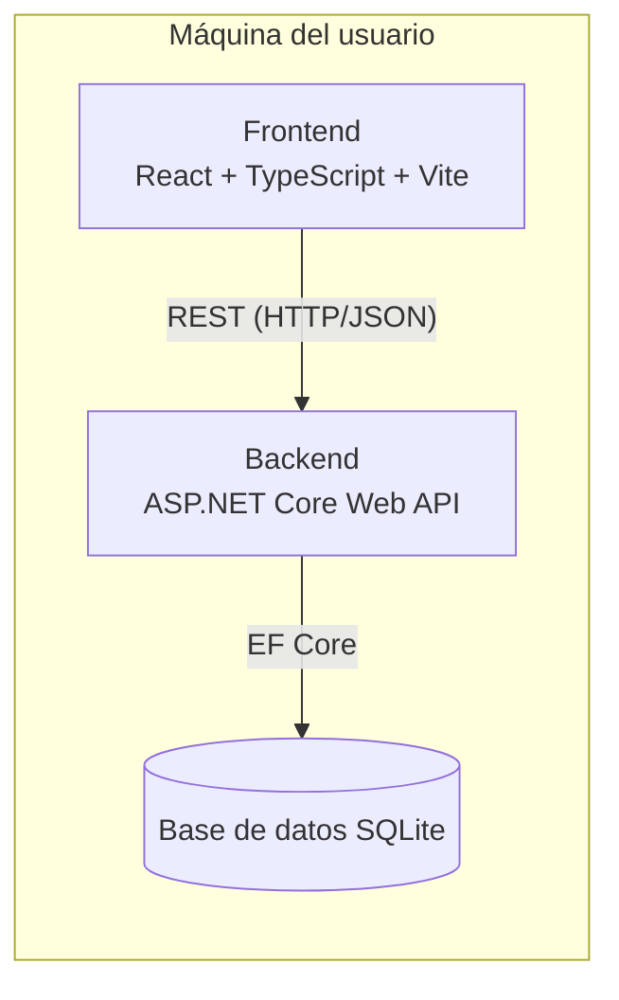

# 📦 Subscription Manager — Alcance del Proyecto

[🇬🇧 English](./ProjectScope.en.md) | 🇪🇸 **Español**

> Aplicación local de gestión de suscripciones para controlar pagos recurrentes, gestionar suscripciones, monitorizar cambios de precio y visualizar gastos mensuales y anuales. Construida con una API REST y una interfaz web moderna, funcionando íntegramente en tu máquina local sin necesidad de infraestructura en la nube.

---

## 📋 Índice

1. [Visión general](#-visión-general)
2. [Objetivos](#-objetivos)
3. [Alcance — MVP v1.0](#-alcance--mvp-v10)
4. [Stack tecnológico](#-stack-tecnológico)
5. [Arquitectura](#-arquitectura)
6. [Estructura del proyecto](#-estructura-del-proyecto)
7. [Fuera de alcance (MVP)](#-fuera-de-alcance-mvp)

---

## 🔎 Visión general

**Subscription Manager** es una aplicación web *local-first* que ayuda a los usuarios a controlar sus suscripciones recurrentes (streaming, software, membresías, etc.).

Ofrece una visión centralizada de:

- A qué servicios está suscrito el usuario.
- Cuánto cuesta cada uno y con qué frecuencia se cobra.
- Cuándo vence el próximo pago o renovación.
- Cómo evoluciona el gasto a lo largo del tiempo (mensual / anual).

**Local-first** significa que toda la aplicación —API y datos— se ejecuta en la propia máquina del usuario. No existe un backend en la nube, ni un servidor de terceros, ni es necesario crear una cuenta para usar la funcionalidad principal. Los datos financieros del usuario nunca salen de su ordenador.

> Para un resumen en lenguaje llano de qué es usable de verdad hoy (y qué no todavía), ver [Qué hace la app, en cristiano](../Features/Features.es.md) — este documento habla de alcance y planificación, aquel habla de las capacidades actuales.

---

## 🎯 Objetivos

- [x] Centralizar todas las suscripciones en una única aplicación.
- [x] Controlar los gastos recurrentes por suscripciones.
- [x] Monitorizar próximos pagos y fechas de renovación.
- [x] Detectar y registrar cambios de precio a lo largo del tiempo.
- [x] Organizar las suscripciones por categorías.
- [x] Llevar el control del estado de cada suscripción (activa, pausada, cancelada).
- [x] Ofrecer una visión clara del gasto mensual y anual.
- [ ] Dejar que el usuario haga todo lo anterior a través de una interfaz web — no llamando a la API directamente.

> Los primeros siete están implementados en el backend, cada uno expuesto como un endpoint REST (ver la [Referencia de la API](../Api/Api.es.md)). El último es lo que realmente falta para que la app sea usable por una persona de principio a fin — ese es el trabajo del frontend, y todavía no ha empezado (ver [Estado del Proyecto](../../README.es.md#-estado-del-proyecto) y la [Hoja de Ruta](../Roadmap/Roadmap.es.md) para lo que está planeado, en orden).

---

## 📐 Alcance — MVP v1.0

La primera versión se centra en el dominio esencial necesario para gestionar suscripciones. Estas tres entidades definen el MVP — ver [Base de Datos](../Database/Database.es.md) para sus atributos, restricciones y relaciones exactas.

| Entidad | Propósito |
|---|---|
| **Subscription (Suscripción)** | Un pago recurrente que el usuario quiere controlar (nombre del servicio, coste, ciclo de facturación, fecha de renovación, estado). |
| **Category (Categoría)** | Agrupa las suscripciones por tipo (p. ej. Streaming, Software, Fitness) para organizar y filtrar los gastos. |
| **PriceHistory (Historial de precios)** | Registra cada cambio de precio de una suscripción (precio anterior, precio nuevo, fecha) para poder consultar su evolución. |

> La aplicación es mono-usuario y de uso exclusivamente local, por lo que no se necesita una entidad `User` en el MVP — no hay login ni datos de varios usuarios que distinguir. Podría introducirse más adelante si se añade sincronización en la nube o soporte multiusuario (ver [Fuera de alcance](#-fuera-de-alcance-mvp)).

---

## 🛠 Stack tecnológico

| Capa | Tecnología |
|---|---|
| Backend / API | ASP.NET Core Web API (.NET 10), C# |
| Persistencia | Entity Framework Core + SQLite |
| Frontend | React, TypeScript, Vite, Tailwind CSS, Framer Motion |
| Testing | xUnit |

---

## 🏗 Arquitectura

Todo se ejecuta en local: la interfaz web habla con la API REST, y la API persiste los datos en una base de datos SQLite local. No interviene ningún servicio en la nube. Ver [Arquitectura y Ciclo de Vida de una Petición](../Architecture/Architecture.es.md) para cómo viaja realmente una petición por el backend, y de qué es responsable cada fichero.



---

## 📁 Estructura del proyecto

```
SubscriptionManager/
├── backend/
│   ├── src/
│   │   └── SubscriptionManager.API/
│   │       ├── Controllers/            # Uno por recurso: Categories, Subscriptions, PriceHistories, Expenses
│   │       ├── DTO/                    # Records de petición/respuesta que exponen los controllers
│   │       ├── Domain/
│   │       │   ├── Entities/           # Category, Subscription, PriceHistory
│   │       │   └── enum/               # BillingCycle, SubscriptionStatus
│   │       ├── Infrastructure/
│   │       │   ├── ArgumentExceptionHandler.cs    # Fallos de validación del dominio -> 400
│   │       │   ├── DbUpdateExceptionHandler.cs     # Violaciones de restricción de la BD -> 409
│   │       │   └── Persistence/
│   │       │       ├── Configurations/ # Configuración Fluent API de EF Core por entidad
│   │       │       └── SubscriptionManagerDbContext.cs
│   │       ├── Migrations/             # Migraciones de EF Core (historial del esquema SQLite)
│   │       └── Program.cs
│   └── tests/                          # Proyecto(s) de tests con xUnit
├── frontend/                           # Aplicación React + TypeScript + Vite
└── docs/                               # Documentación del proyecto
```

---

## 🚫 Fuera de alcance (MVP)

Lo siguiente **no** forma parte de la v1.0. Podría considerarse en futuras iteraciones:

- Soporte multiusuario / autenticación entre dispositivos.
- Notificaciones push o recordatorios por email.
- Integraciones directas con bancos o proveedores de pago.
- Aplicación móvil.
- Sincronización / copia de seguridad en la nube.

---

<p align="center"><sub>Última actualización: 2026-11-15</sub></p>
